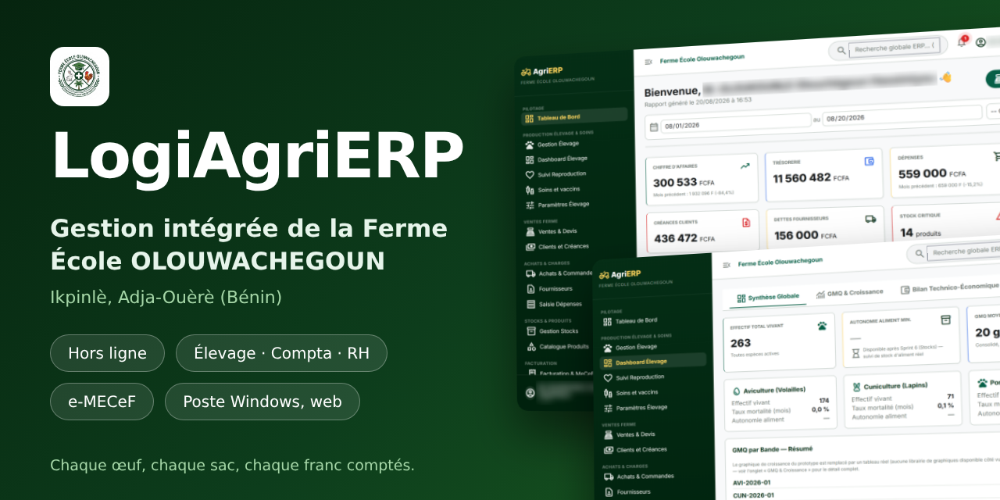
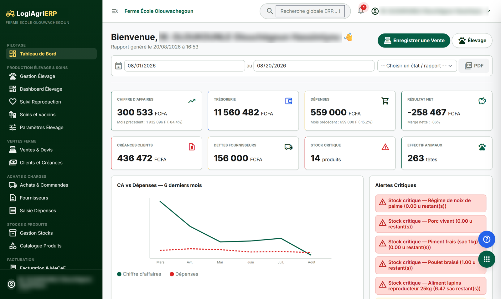
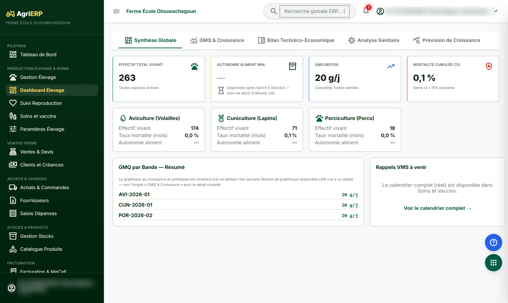
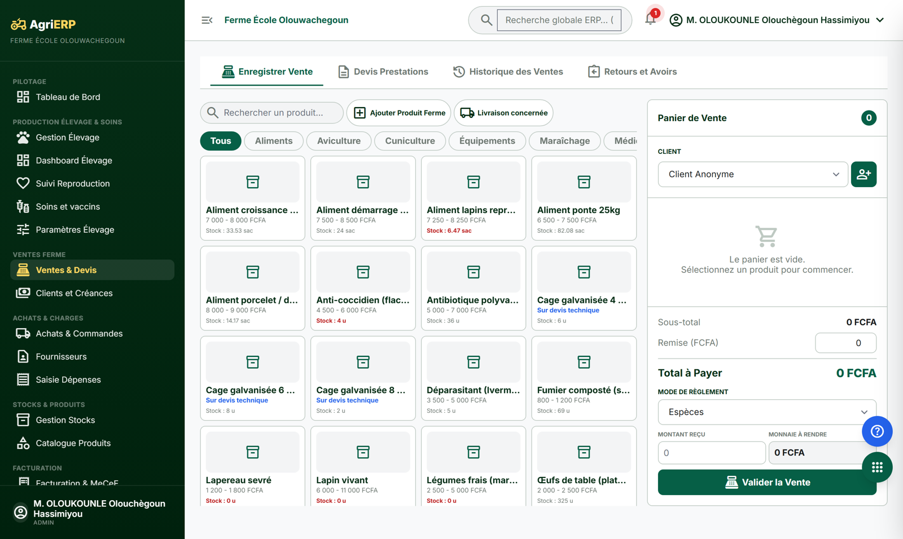
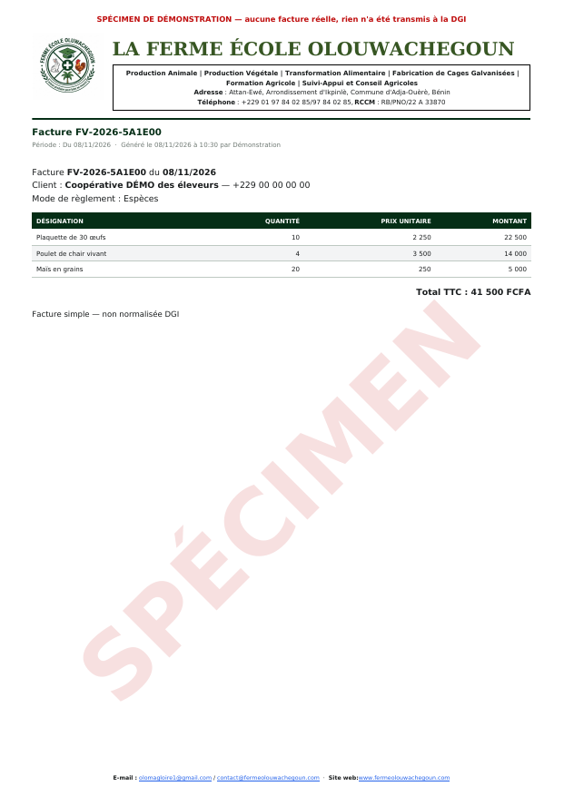
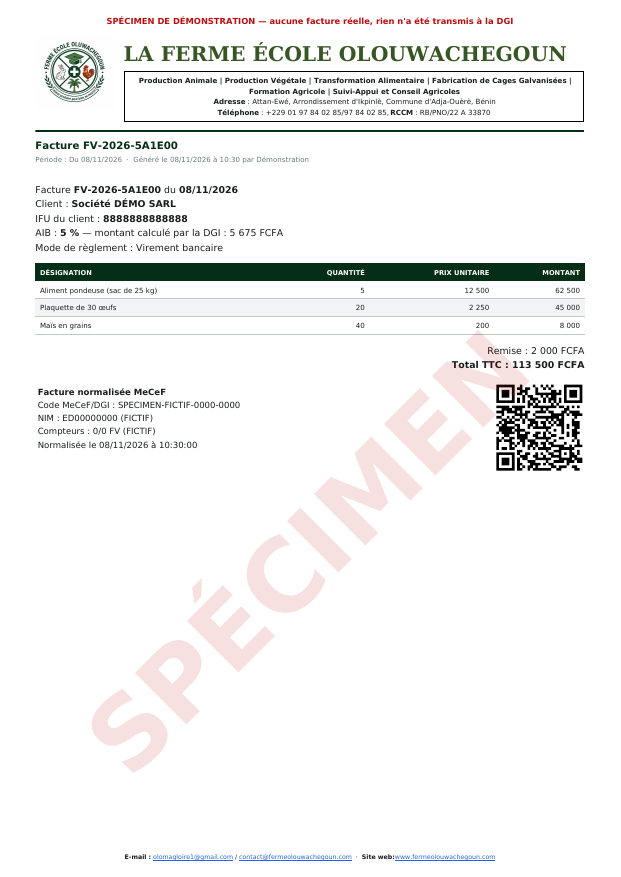
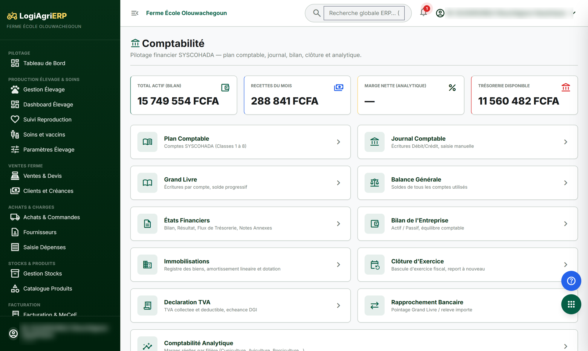

# LogiAgriERP

**Le logiciel de gestion d'une ferme, du poulailler jusqu'au bilan comptable.**

Élevage · Ventes · Achats · Stocks · Comptabilité SYSCOHADA · RH et paie · Facturation normalisée e-MECeF

---

## Le projet

LogiAgriERP est un projet personnel : un système de gestion intégrée conçu pour la **Ferme École OLOUWACHEGOUN** (Ikpinlè, commune d'Adja-Ouèrè, Bénin).

Il remplace les cahiers, les tableurs et les calculs à la main. On y enregistre chaque œuf ramassé, chaque sac de provende acheté, chaque vente et chaque paie, et le logiciel en déduit **les stocks, les marges par bande, les écritures comptables, les factures et les états de gestion**, sans ressaisie.

Il s'utilise de trois façons :

- **sur le web**, dans un navigateur, pour le bureau, la comptabilité et l'administration ;
- **sur un poste Windows**, installé à la ferme ;
- **dans un navigateur sans installation**, y compris sans Internet.

La ferme n'a pas toujours du réseau, donc le poste fonctionne **entièrement hors ligne** et se synchronise tout seul dès que la connexion revient.

---

## Fonctionnalités principales

### 📊 Tableau de bord

Chiffre d'affaires, trésorerie, dépenses, résultat net, créances clients, dettes fournisseurs, stock critique et effectif des animaux, d'un seul coup d'œil. Les alertes critiques remontent en tête, et un état peut être imprimé en PDF sur la période de son choix.

### 🐓 Élevage

Gestion par **bandes** et par **sujets** pour la volaille (pondeuses, poulets), les lapins, les porcs et les escargots :

- saisie journalière (ponte, mortalité, aliment, pesées avec estimation automatique du poids) ;
- rations et provendes, croissance (GMQ), bilan technico-économique, rentabilité par bande ;
- reproduction, soins et vaccins, calendrier vétérinaire, infirmerie, rappels automatiques ;
- relevés de terrain, transferts entre bandes, transformation des produits.

### 🛒 Ventes et caisse

Point de vente avec panier, clients, remises, modes de règlement et monnaie à rendre. Devis, historique des ventes, retours et avoirs, créances, relances et avances clients. La caisse peut encaisser **sans réseau**, y compris depuis un simple navigateur.

### 🧾 Factures et facturation normalisée e-MECeF

Factures **simples** ou **normalisées** conformes au système e-MECeF de la DGI du Bénin : IFU du client, taux d'AIB, code MECeF et QR code. Une facture normalisée est verrouillée : on la corrige par un avoir.

<table>
<tr>
<td width="50%"></td>
<td width="50%"></td>
</tr>
<tr>
<td align="center"><em>Facture simple (spécimen)</em></td>
<td align="center"><em>Facture normalisée (spécimen)</em></td>
</tr>
</table>

### 📦 Achats et stocks

Fournisseurs, bons de commande, factures d'achat, dettes et pièces justificatives. Produits, mouvements de stock, seuils d'alerte, dons, et **import Excel en masse**.

### 📒 Comptabilité SYSCOHADA

Chaque opération génère automatiquement ses écritures au plan comptable SYSCOHADA. On y trouve le journal, le grand livre, la balance (générale et âgée), le bilan, les états financiers, la déclaration de TVA, le rapprochement bancaire, les immobilisations, la comptabilité analytique et la clôture d'exercice.

### 👥 Ressources humaines

Registre des employés et des stagiaires, feuille de pointage, **paie** (barème ITS, CNSS) et attestations officielles en PDF.

### ⚙️ Et aussi

- **Quatre rôles** (administrateur, comptable, caissier, animalier) avec des droits fins.
- **Notifications** : stock critique, rappels de soins, échéances.
- **Administration** : données de la ferme, logo, utilisateurs, sauvegardes, appairage des postes.
- **Aide intégrée** : assistant de démarrage, aide par écran, visite guidée.
- **Un manuel d'utilisation** illustré.

---

## Sous le capot

| | |
|---|---|
| **Serveur web** | Laravel 12, Livewire 3, Alpine.js, Tailwind, MySQL |
| **Poste** | Flutter (Windows et navigateur), base locale SQLite (Drift) |
| **Synchronisation** | Hors ligne d'abord, envoi par lots, aucune saisie perdue ni écrasée |
| **Qualité** | Environ 3 300 tests côté serveur et 4 300 côté poste |
| **Langue** | Tout le logiciel est en français |

---

## Contact et usage commercial

Ce projet est **privé et personnel**. Tous droits réservés.

Pour toute utilisation commerciale, une démonstration ou une collaboration, écrivez à :

📧 **[rarhodes06@gmail.com](mailto:rarhodes06@gmail.com)**
