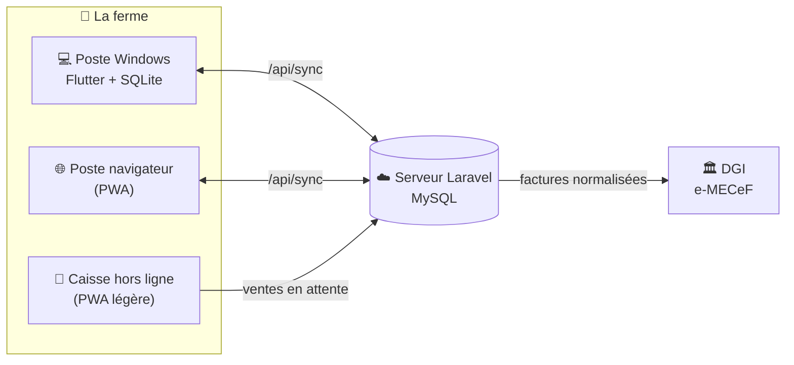
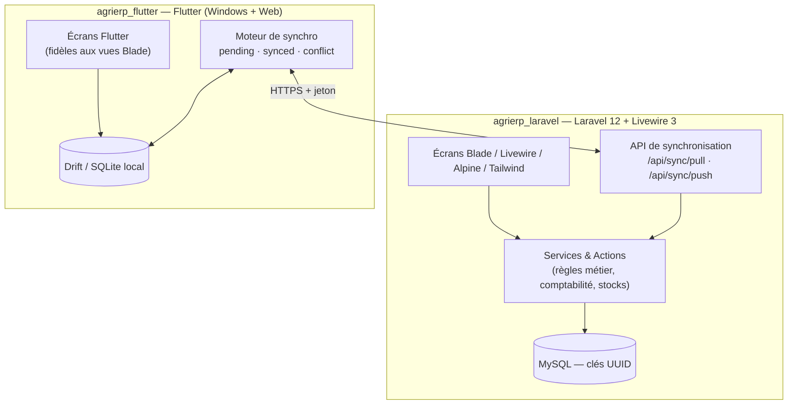
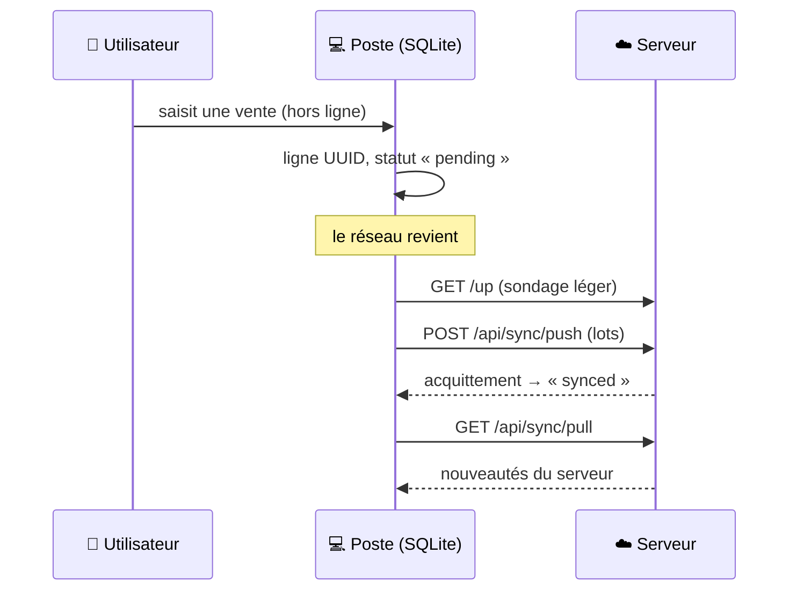

<div align="center">

# 🌾 AgriERP

**Le système de gestion intégrée de la Ferme École OLOUWACHEGOUN**
Élevage · Ventes · Achats · Stocks · Comptabilité SYSCOHADA · Ressources humaines · Facturation normalisée e-MECeF

*Ikpinlè, commune d'Adja-Ouèrè, Bénin — PAEB / Cabinet FAGUEZ SARL*


</div>

---

## Sommaire

1. [En une page](#1-en-une-page)
2. [Pour qui, pour quoi](#2-pour-qui-pour-quoi)
3. [Architecture d'ensemble](#3-architecture-densemble)
4. [Les modules métier](#4-les-modules-métier)
5. [Hors ligne et synchronisation](#5-hors-ligne-et-synchronisation)
6. [Facturation normalisée e-MECeF](#6-facturation-normalisée-e-mecef)
7. [Comptabilité SYSCOHADA](#7-comptabilité-syscohada)
8. [Rôles et droits](#8-rôles-et-droits)
9. [Les trois façons d'utiliser AgriERP](#9-les-trois-façons-dutiliser-agrierp)
10. [Démarrage rapide](#10-démarrage-rapide)
11. [Tests et qualité](#11-tests-et-qualité)
12. [Arborescence du dépôt](#12-arborescence-du-dépôt)
13. [Règles de travail](#13-règles-de-travail)
14. [Documentation](#14-documentation)
15. [Sécurité et données](#15-sécurité-et-données)

---

## 1. En une page

AgriERP remplace les cahiers, les tableurs et les calculs à la main d'une ferme-école : on y enregistre chaque œuf ramassé,
chaque sac de provende acheté, chaque vente, chaque paie, et le logiciel en tire **les stocks, les marges par bande, les
écritures comptables, les factures normalisées et les états de gestion**.

Deux idées structurent tout le produit :

| Idée | Conséquence |
|---|---|
| **La ferme n'a pas toujours Internet.** | Le poste de travail fonctionne **entièrement hors ligne** et se synchronise dès que le réseau revient. |
| **Une seule vérité.** | Le **web (Laravel)** est le maître : les règles métier, les calculs et les écrans y naissent, le poste les **reprend à 100 %**. |



---

## 2. Pour qui, pour quoi

| Qui | Ce qu'il fait dans AgriERP |
|---|---|
| **Administrateur** | Paramètre la ferme, gère les utilisateurs, valide, corrige, clôture l'exercice. |
| **Comptable** | Journal, grand livre, balance, bilan, rapprochement bancaire, paie, déclarations. |
| **Caissier** | Ventes, encaissements, factures, caisse (même sans réseau). |
| **Animalier** | Saisies journalières d'élevage : ponte, mortalité, aliment, soins, pesées. |

---

## 3. Architecture d'ensemble



| Brique | Technologie | Rôle |
|---|---|---|
| **Serveur web** | Laravel 12, Livewire 3, Alpine.js, Tailwind CLI, PHP 8.3, MySQL | Écrans, règles métier, droits, API de synchronisation |
| **Poste** | Flutter, Drift (SQLite), `build_runner` | Client *offline-first* : Windows (référence) et navigateur (PWA) |
| **Caisse hors ligne** | JavaScript, IndexedDB, chiffrement AES-GCM (clé dérivée du code PIN) | Encaisser sans réseau depuis un navigateur |
| **Manuel** | HTML → PDF | Manuel d'utilisation avec captures |
| **Spécimens** | PHP | `presentation/` : factures A4, facture normalisée, ticket d'essai MeCeF |

Choix structurants :

- **Clés primaires UUID** sur toutes les tables synchronisables (jamais d'entier auto-incrémenté) : un poste hors ligne peut créer des
  lignes sans risque de collision.
- **Schéma partagé** : toute table modifiée côté Laravel (migration) l'est aussi côté Flutter (`app_database.dart`), et inversement.
- **Écrivain unique par table** : chaque donnée a un seul chemin d'écriture, garanti par des garde-fous de test.
- **Tout en français** : libellés, messages, commentaires, noms de tests, commits.

---

## 4. Les modules métier

| Module | Ce qu'il couvre |
|---|---|
| 🐓 **Élevage** | Bandes et sujets, plusieurs espèces (pondeuses, poulets de chair, lapins, escargots…), saisie journalière, mortalité, pesées avec estimation automatique du poids, rations et provendes, prophylaxie et calendrier vétérinaire, infirmerie, transferts entre bandes, transformations, rentabilité par bande, **relevés de terrain** (saisis puis « Validés »). |
| 🛒 **Ventes** | Panier, devis, conversion en facture, avoirs, créances, relances, avances clients, fidélité, caisse. |
| 📦 **Achats** | Fournisseurs, bons de commande, factures d'achat, dettes, pièces justificatives. |
| 🏬 **Stocks** | Produits, mouvements, seuils d'alerte, dons, import **Excel en masse**. |
| 📒 **Comptabilité** | Journal, grand livre, balance (âgée), bilan, compte de résultat, rapprochement bancaire, exercices N / N-1 / N+1, clôture. |
| 👥 **RH** | Registre des employés et des stagiaires, feuille de pointage, **paie** (barème ITS, CNSS), attestations officielles (PDF). |
| 🧾 **Facturation** | Facture simple ou **normalisée e-MECeF**, avoirs, retransmission. |
| 📊 **Tableau de bord et rapports** | KPI, tableau de bord Élevage, états à période choisie, exports PDF. |
| 🔔 **Notifications** | Alertes de stock, rappels de soins (VMS), échéances. |
| ⚙️ **Administration** | Données de l'entreprise, logo et favicon, utilisateurs, sauvegardes, sessions, appairage des postes, réinitialisations. |
| ❓ **Aide** | Assistant de démarrage, aide par écran, visite guidée. |

---

## 5. Hors ligne et synchronisation

Le poste lit et écrit **dans sa base locale** ; le réseau n'est jamais un obstacle à la saisie.



| Règle | Détail |
|---|---|
| **États d'une ligne** | `pending` (à envoyer), `synced`, `conflict`. |
| **Jamais d'écrasement** | Une ligne `pending` ou `conflict` n'est jamais écrasée par un tirage du serveur. |
| **Lots** | Envoi par lots de 50 ; tirage incrémental avec écritures groupées. |
| **Appairage** | Chaque poste est appairé au serveur par jeton ; le jeton e-MECeF n'est **jamais** servi aux postes. |
| **Sauvegarde** | Export JSON complet ; restauration au web seulement dans un état sûr (rien en attente) et par confirmation. |

**PWA** : le poste existe aussi en version navigateur (Flutter Web servi sous `/poste/`, IndexedDB, service worker propre) et la
**caisse hors ligne** permet d'encaisser depuis un simple navigateur, données chiffrées localement.

---

## 6. Facturation normalisée e-MECeF

AgriERP sait émettre une **facture normalisée** conforme au système e-MECeF de la DGI du Bénin.

| Mode | Principe |
|---|---|
| **Désactivé** | Factures simples uniquement (par défaut). |
| **e-MECeF (compte en ligne)** | La ferme possède un compte e-MECeF : le serveur transmet la facture et reçoit le code MECeF, le QR code et les compteurs. |
| **Boîtier** | Boîtier fiscal branché au poste (squelette prêt, à brancher). |

À la vente, le caissier choisit **facture simple ou normalisée** ; la normalisée demande l'IFU, le nom du client et le taux d'AIB (5 %).
Les prix sont des **montants entiers**, la livraison est incluse dans la vente. Une facture normalisée est **verrouillée** : on la corrige
par un **avoir**.

Le jeton e-MECeF se saisit **sur le web uniquement** (chiffré, jamais affiché, jamais envoyé au poste). Les variables `SGMEF_*` du `.env`
ne servent que de valeurs de repli : le réglage saisi à l'écran prime toujours.

---

## 7. Comptabilité SYSCOHADA

Chaque opération métier génère **automatiquement** ses écritures au plan SYSCOHADA (1 337 comptes), par un point d'entrée unique
(`AccountingEntryService::record()`) : vente, achat, paie, règlement, don, transformation… Les stocks passent, eux aussi, par une action
unique. Résultat : le journal, le grand livre, la balance et le bilan sont toujours cohérents avec ce qui a été saisi, sans ressaisie.

---

## 8. Rôles et droits

Quatre rôles réels, deux niveaux de contrôle (route `can:` et `authorize()` dans le composant) :

| Rôle | Périmètre |
|---|---|
| `admin` | Tout, dont les paramètres, les utilisateurs et la clôture. |
| `comptable` | Comptabilité, paie, lecture des ventes, achats et stocks. |
| `caissier` | Ventes, facturation, encaissements. |
| `animalier` | Saisies d'élevage. |

Droits fins : `view-*`, `manage-*`, et `correct-invoices` pour les avoirs et la retransmission d'une facture.

---

## 9. Les trois façons d'utiliser AgriERP

| Surface | Quand | Réseau |
|---|---|---|
| 🖥️ **Web** (navigateur) | Bureau, comptabilité, administration | Requis |
| 💻 **Poste Windows** (installateur) | Poste de la ferme, usage quotidien | Facultatif |
| 🌐 **Poste navigateur / caisse hors ligne** | Poste sans installation, caisse de secours | Facultatif |

---

## 10. Démarrage rapide

Guide complet pas à pas (Windows, clonage, tests, installateur) : [`docs/INSTALLATION_LOCALE.md`](docs/INSTALLATION_LOCALE.md).
Déploiement en production : [`docs/GUIDE_DEPLOIEMENT.md`](docs/GUIDE_DEPLOIEMENT.md).

### Application web — `agrierp_laravel/`

```bash
cd agrierp_laravel
composer install
npm install
cp .env.example .env
php artisan key:generate
php artisan migrate:fresh --seed     # crée la base, les rôles et des données de démonstration
npm run build                        # ou : npm run dev
php artisan storage:link
php artisan serve --port=8002
```

### Poste — `agrierp_flutter/`

```bash
cd agrierp_flutter
flutter pub get
dart run build_runner build          # après un changement de schéma
flutter run -d windows               # ou : flutter run -d chrome
build_windows.bat                    # Windows : build Release + installateur AgriERP-Setup-<version>.exe
```

Prérequis poste Windows : Flutter (version épinglée dans `.fvmrc`), Visual Studio 2022 (charge de travail C++), Inno Setup 6.

### Base de données

Aucun export SQL n'est versionné : la base se reconstruit par `php artisan migrate:fresh --seed`.

---

## 11. Tests et qualité

```bash
# Web
cd agrierp_laravel && php artisan test --testsuite=Feature

# Poste
cd agrierp_flutter && flutter analyze && flutter test
```

| Suite | Volume actuel |
|---|---|
| Laravel (`Feature`) | ≈ 3 300 tests |
| Flutter | ≈ 4 300 tests (une vingtaine se sautent quand une dépendance manque : dépôt Laravel, PHP ou maquette HTML) |
| Navigateur (Chromium) | scénarios bout en bout de la PWA : reconnexion, deux onglets, mise à jour du service worker |

Particularités de la méthode :

- **Garde-fous qui lisent les sources** : un test échoue si un écran, un libellé, une icône ou un droit s'écarte du web.
- **Tests de parité qui exécutent le vrai PHP** : le poste est comparé au rendu réel de la vue Blade.
- **Épreuve de mutation** : on casse volontairement le code pour vérifier que le test rougit.
- La suite Laravel a besoin de `npm run build` et de `php artisan storage:link`, sinon 10 tests échouent pour des raisons d'environnement.

---

## 12. Arborescence du dépôt

```text
agrierp/
├── agrierp_laravel/        # Application web Laravel 12 + Livewire 3 + API de synchronisation
│   ├── app/                #   Livewire, Services, Actions, Support
│   ├── database/           #   migrations, seeders
│   ├── resources/views/    #   vues Blade (le maître visuel)
│   └── tests/              #   Feature, JS, e2e navigateur
├── agrierp_flutter/        # Poste Flutter offline-first (Windows + Web)
│   ├── lib/core/           #   base Drift, synchro, export, widgets
│   ├── lib/features/       #   un dossier par module
│   ├── web/                #   PWA : service worker, manifest
│   └── test/ · outils/     #   tests et scripts (build web, e2e)
├── manuel/                 # Manuel d'utilisation (HTML → PDF)
├── presentation/           # Spécimens : factures A4, normalisée, ticket d'essai MeCeF
├── docs/                   # Doctrine, plan, guides, PRD, documents LogiALVIA
└── CLAUDE.md               # Consignes de travail (assistant de code)
```

---

## 13. Règles de travail

- **Fidélité absolue web ↔ poste** : la vue Blade est le maître. Un critère absent du web se construit d'abord sur le web.
- **Tout en français** (prose, libellés, commentaires, tests, commits).
- `app_database.g.dart` est **généré** : ne jamais l'éditer à la main.
- Aucun `*.sql`, aucune archive `*.zip`, aucun `.env` n'est versionné.
- Chaque projet a son `CLAUDE.md` : à lire avant toute modification, puis
  [`docs/DOCTRINE_PORTAGE.md`](docs/DOCTRINE_PORTAGE.md) et [`docs/PLAN_FINALISATION.md`](docs/PLAN_FINALISATION.md).

---

## 14. Documentation

| Document | Contenu |
|---|---|
| [`docs/INSTALLATION_LOCALE.md`](docs/INSTALLATION_LOCALE.md) | Installer et lancer web + poste en local |
| [`docs/GUIDE_DEPLOIEMENT.md`](docs/GUIDE_DEPLOIEMENT.md) | Mise en production |
| [`docs/DOCTRINE_PORTAGE.md`](docs/DOCTRINE_PORTAGE.md) | Règles de fidélité web ↔ poste |
| [`docs/PLAN_FINALISATION.md`](docs/PLAN_FINALISATION.md) | Tickets restants et décisions client en attente |
| [`docs/BLUEPRINT_SYNCHRONISATION_MULTIPOSTES.md`](docs/BLUEPRINT_SYNCHRONISATION_MULTIPOSTES.md) | Conception de la synchronisation |
| [`docs/INVENTAIRE_TACHES.md`](docs/INVENTAIRE_TACHES.md) | Inventaire des tâches |
| [`docs/prd/`](docs/prd/) | Spécifications fonctionnelles (PRD) |
| [`docs/logialvia/`](docs/logialvia/) | Guide de portage et décisions pour le logiciel frère LogiALVIA |
| [`manuel/`](manuel/) | Manuel d'utilisation |
| [`presentation/`](presentation/) | Spécimens de documents (factures, ticket MeCeF) |

---

## 15. Sécurité et données

- **Dépôt privé.** Aucun secret n'est versionné : pas de `.env`, pas d'export de base, pas de jeton.
- Le jeton e-MECeF est **chiffré**, saisi au web seulement, **jamais affiché ni envoyé aux postes ni journalisé**.
- Les accès sont contrôlés à deux niveaux (route et composant) ; les mots de passe sont hachés ; les sessions peuvent être vidées par l'administrateur.
- La caisse hors ligne chiffre ses données localement avec une clé dérivée du code PIN.
- Un export de base contenant des hash de mots de passe a été retiré de tout l'historique le 17/10/2026.

---

<div align="center">

*AgriERP — pour que chaque œuf, chaque sac et chaque franc soient comptés.*

</div>
