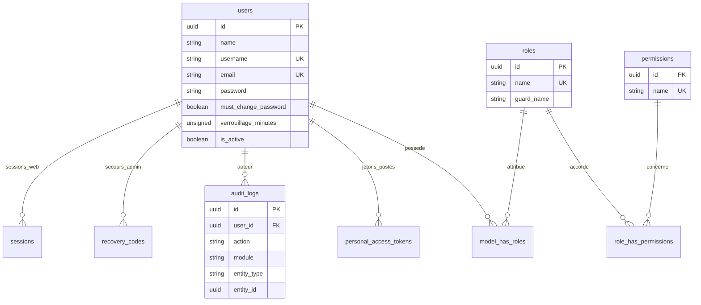
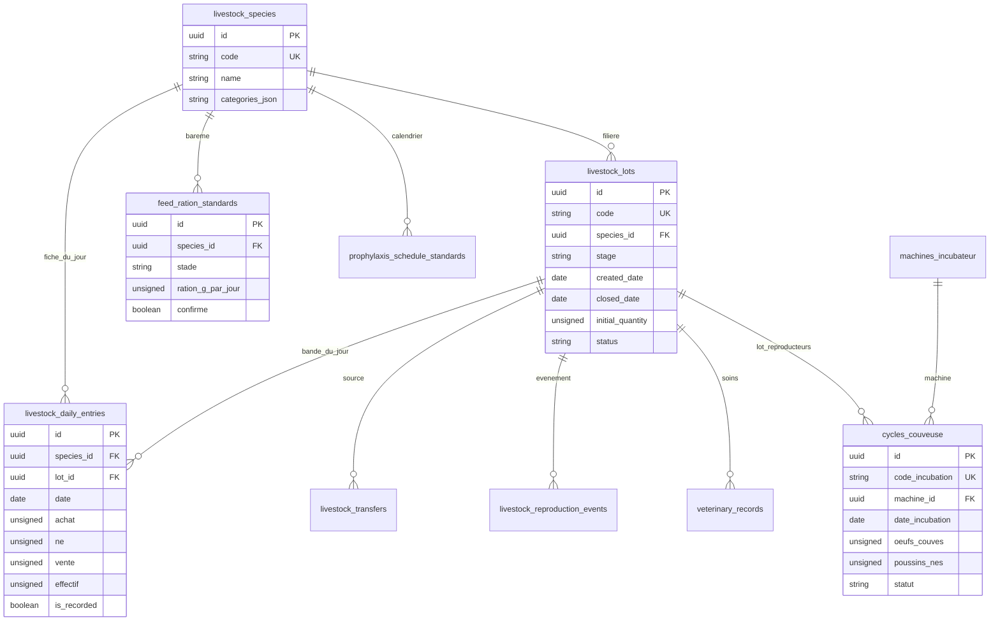
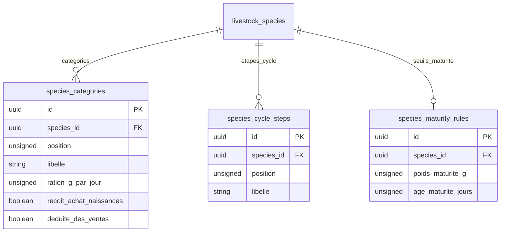
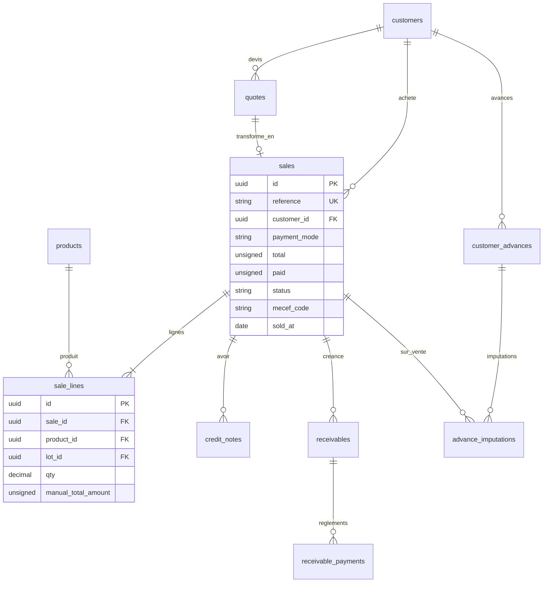
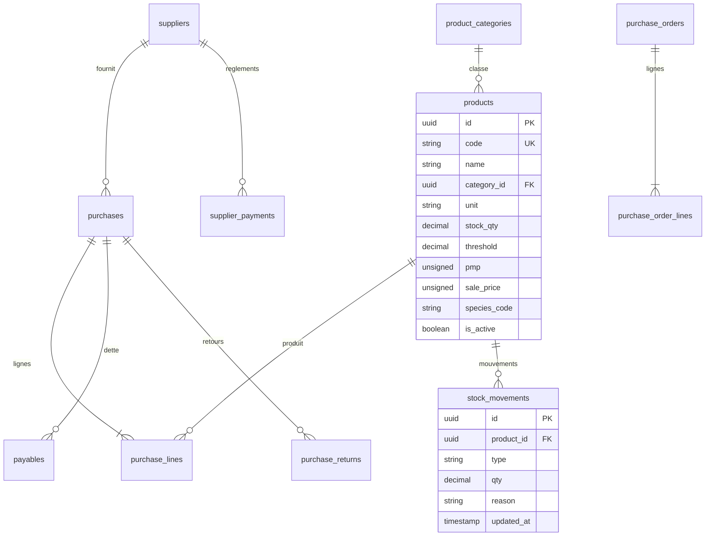
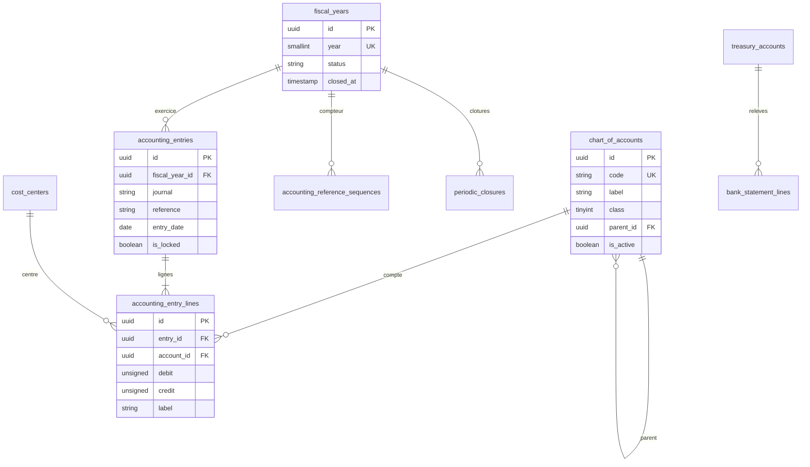
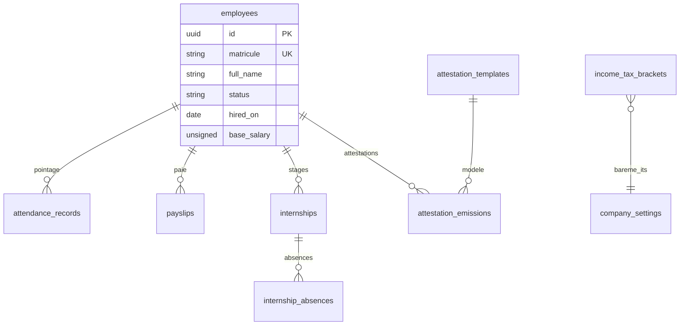
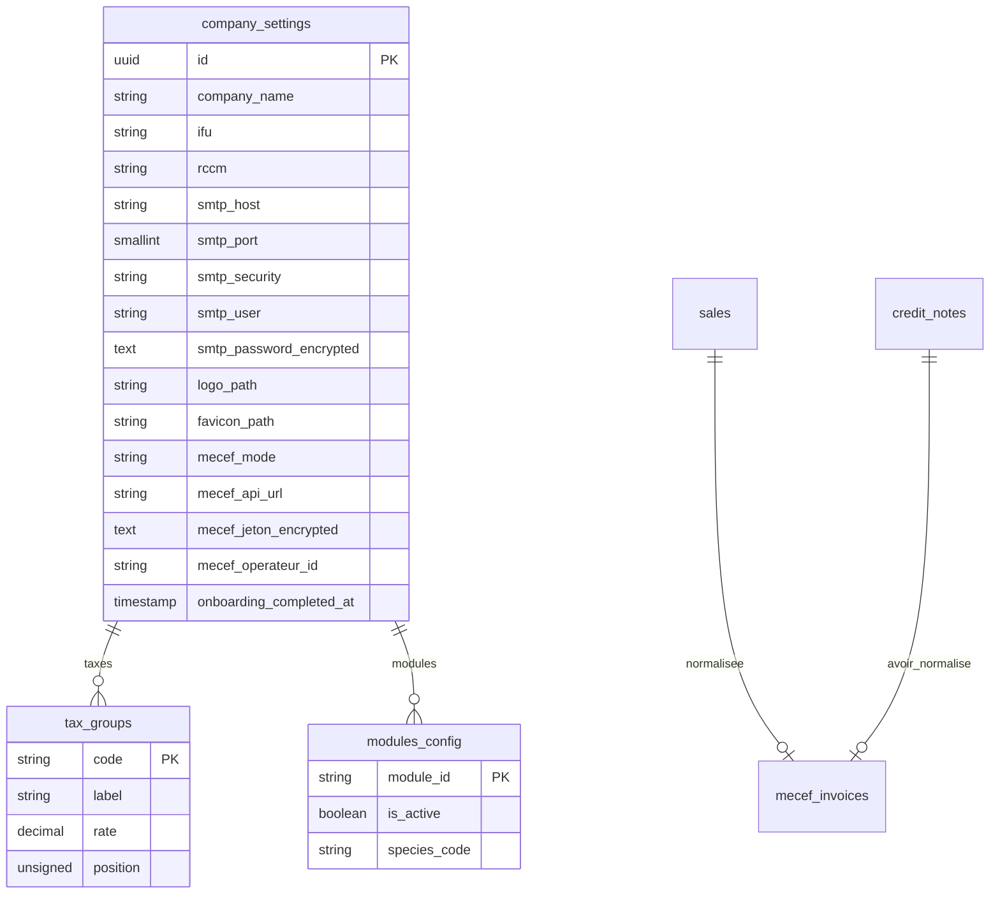
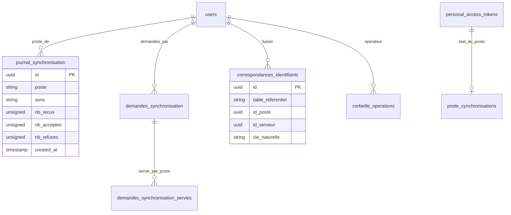

# 30 — DATABASE ENGINEERING : modèle de données du web LogiALVIA

> **USAGE**
> - **Quand l'utiliser** : après `02_ARCHITECTURE_WEB_ET_STACK.md` (pile et conventions figées) et après `10_BRS…` à `15_REGLES_METIER` (ce qu'on stocke), AVANT d'écrire le moindre modèle Eloquent, composant Livewire ou fichier `20_MODULES_*`. Toute table du web naît ici.
> - **Ordre** : (1) lire ce fichier en entier ; (2) lancer le **prompt P0** (audit de départ) ; (3) lancer les prompts **P1 à P9**, UN domaine par session (règle « un ticket = une session », `agrierp_laravel/CLAUDE.md` § Working rhythm) ; (4) lancer **P10** (plan de migration des données de logialvia) ; (5) **P11** (seeders) ; (6) **P12** (contrôle de parité du schéma Laravel ↔ Drift).
> - **Entrées** : ce fichier ; `docs/logialvia/GUIDE_PORTAGE_VERS_AUTRE_LOGICIEL.md` (à lire, pas à réécrire : il fixe l'ordre de portage et les pièges déjà payés) ; le schéma réel d'LogiAgriERP (`agrierp_laravel/database/migrations/`, `agrierp_flutter/lib/core/database/app_database.dart`, schéma Drift v85) ; le schéma réel de logialvia (`/home/user/massenon/logialvia/logialvia_app/lib/*/data/tables/`, schéma Drift v26, + `docs/04_MODELE_DONNEES_PERSISTANCE.md`, `docs/D1_Modele_Donnees_ERD_Dictionnaire.md`, `docs/05_LOGIQUE_CALCUL_FORMULAIRES.md`).
> - **Sorties** : migrations Laravel (`agrierp_laravel`-like : `<web LogiALVIA>/database/migrations/`), modèles, seeders, tables Drift jumelles, tests de schéma, mise à jour du dictionnaire ci-dessous (ce fichier reste la source : tout écart est corrigé ICI dans le même commit).
> - **Règle d'or** : aucune règle métier inventée. Ce qui n'est écrit dans aucune source est marqué **« À DÉFINIR AVEC LE CLIENT »** et listé dans la section 14 (questions). Les noms de colonnes d'LogiAgriERP sont réutilisés tels quels quand la notion est identique (un seul vocabulaire pour les deux produits).
> - **Fichiers frères** : `01_MASTER_PROMPT.md`, `02_ARCHITECTURE_WEB_ET_STACK.md`, `03_DEVELOPMENT_STANDARDS.md`, `15_REGLES_METIER.md`, `20_MODULES_*`, `40_PWA_HORS_LIGNE.md`, `41_MECEF_EMECEF.md`, `42_CONFIG_MECEF_SMTP_LOGO_FAVICON.md`, `43_APPAIRAGE_SYNCHRO_MODALE_ALERTES.md`, `31_TESTING_QA.md`, `32_CLAUDE_CODE_SKILLS_LIBRARY.md`.

---

## Sommaire

1. Principes non négociables
2. Chemins de référence (vérifiés)
3. Conventions de colonnes (types, montants, dates, synchro, suppression logique, énumérations)
4. ERD par domaine (8 diagrammes Mermaid)
5. Dictionnaire de données des tables essentielles
6. Filières : pisciculture, pintades, goliaths (ce qui est défini, ce qui reste à définir)
7. Contraintes, index, performance, pagination
8. Migrations : ordre, idempotence, pièges MariaDB
9. Plan de migration des données existantes de logialvia (25 clés entières → UUID)
10. Seeders
11. Schéma partagé Laravel ↔ Drift et contrôle d'intégrité
12. Sauvegarde et restauration
13. Prompts de génération (P0 à P12)
14. Questions ouvertes pour le client
15. Critères d'acceptation globaux

---

## 1. Principes non négociables

1. **UUID partout.** Toute clé primaire est un UUID (`$table->uuid('id')->primary()`, `HasUuids` côté Eloquent, `TextColumn` côté Drift). Aucun `increments()`, `id()`, `bigIncrements()`. Les lignes de comptage internes (`accounting_reference_sequences`) ont une clé composite métier, pas d'entier auto. Conséquence directe sur logialvia : 25 colonnes `autoIncrement` à convertir (section 9).
2. **Le web est le maître du schéma** (doctrine, article 0) ; le poste Drift le reproduit. Toute table synchronisable modifiée d'un côté l'est de l'autre, dans le même ticket (section 11).
3. **Suppression logique seulement** sur toute donnée comptable, zootechnique ou commerciale : `is_active = false` ou énumération `status`. `DELETE` physique interdit, sauf référentiels non référencés via la Corbeille (mot « SUPPRIMER »). Les écritures comptables ne se restaurent jamais : on les contre-passe.
4. **Montants entiers en FCFA** : `unsignedBigInteger` (ou `bigInteger` si un solde peut être négatif). Aucun `float`, aucun `decimal` pour de l'argent. Les quantités physiques (kg, litres, sujets partiels) restent `decimal`. ⚠️ LogiAgriERP utilise encore `decimal(14,2)` (vérifié dans `2026_02_16_000002_create_sales_and_lines_tables.php`) : LogiALVIA, nouveau produit, applique l'entier dès le départ. Ne pas copier `decimal(14,2)` d'LogiAgriERP.
5. **Dates en heure du Bénin** (`Africa/Porto-Novo`, UTC+1, pas d'heure d'été) : `APP_TIMEZONE=Africa/Porto-Novo` (LogiAgriERP laisse `env('APP_TIMEZONE','UTC')` dans `config/app.php` : LogiALVIA fixe la valeur dans `.env.example` ET dans `config/app.php`). Un « jour » (fiche journalière, échéance) est une colonne `date`, jamais un `timestamp`.
6. **Chaque table synchronisable porte** `device_id`, `sync_status`, `updated_at` (section 3.4).
7. **Un seul point de passage** pour toute règle qui écrit (Action ou Service) ; la base garde les invariants qu'elle peut garder (clés étrangères, uniques, CHECK).
8. **Les migrations ne se modifient jamais après livraison** : on en ajoute une. Elles sont idempotentes (`hasTable`/`hasColumn`).
9. **Aucun export `*.sql`, aucune archive, aucun `.env` versionné** (CLAUDE.md racine). La base se reconstruit par `php artisan migrate:fresh --seed`.

## 2. Chemins de référence (vérifiés par `ls`)

| Sujet | Chemin |
|---|---|
| Migrations LogiAgriERP (141 fichiers) | `/home/user/agrierp/agrierp_laravel/database/migrations/` |
| Exemple FK + enum + index | `.../2026_02_10_000001_create_livestock_lots_table.php` |
| Table singleton de réglages (SMTP, logo, favicon) | `.../2026_02_20_000001_create_company_settings_table.php` |
| Réglage MeCeF | `.../2026_11_07_000001_add_mecef_reglage_to_company_settings.php`, `..._000002_add_mecef_normalisation_to_sales_and_credit_notes.php` |
| Compteur sous verrou | `.../2026_10_09_000004_create_accounting_reference_sequences_table.php` |
| Tables propres au serveur (synchro) | `.../2026_10_19_000001_create_journal_synchronisation_table.php`, `..._000003_create_demandes_synchronisation_tables.php`, `..._000010_create_correspondances_identifiants_table.php`, `.../2026_10_21_000002_create_poste_synchronisations_table.php` |
| Migration idempotente | `.../2026_10_23_000001_create_corbeille_operations_table.php` |
| Enum étendu, MariaDB vs SQLite | `.../2026_02_28_000003_add_retard_to_attendance_records_status_enum.php`, `.../2026_11_05_000005_add_quatre_to_livestock_transfers_categorie.php` |
| Plan SYSCOHADA (1 332 comptes) | `agrierp_laravel/database/data/plan-comptable-syscohada-revise.csv`, `app/Services/ImporterPlanSyscohadaService.php` (retourne `empreinte` SHA-256 du fichier) |
| Seeders LogiAgriERP | `agrierp_laravel/database/seeders/` (`RolesAndPermissionsSeeder`, `ChartOfAccountsSeeder`, `FeedRationStandardsSeeder`, `ModulesConfigSeeder`, `LivestockSpeciesSeeder`, `DemoDataSeeder` + `Demo/`) |
| Schéma Drift LogiAgriERP (v85) | `/home/user/agrierp/agrierp_flutter/lib/core/database/app_database.dart` (`schemaVersion => 85`) ; généré : `app_database.g.dart` (jamais à la main) |
| Tests de schéma / migrations du poste | `agrierp_flutter/test/migration_toutes_versions_test.dart`, `migration_bases_reelles_test.dart`, `corbeille_schema_test.dart`, `avoirs_schema_test.dart` |
| Essai multipostes MariaDB | `agrierp_flutter/outils/essai_multipostes.sh` |
| Tables Drift de logialvia (22 fichiers) | `/home/user/massenon/logialvia/logialvia_app/lib/{administration,approvisionnement,commercial,comptabilite,elevage}/data/tables/` ; schéma `versionSchema = 26` dans `logialvia_app/lib/core/database/app_database.dart` |
| Configuration des filières logialvia | `logialvia_app/lib/elevage/domain/entities/configuration_espece.dart` |
| Amorçage logialvia | `logialvia_app/lib/core/database/seed/seed_initial.dart` |
| Dossiers de logialvia | `docs/04_MODELE_DONNEES_PERSISTANCE.md`, `docs/D1_Modele_Donnees_ERD_Dictionnaire.md`, `docs/05_LOGIQUE_CALCUL_FORMULAIRES.md`, `docs/B6_Regles_Metier.md`, `docs/F3_Module_Production_Elevage.md` |

## 3. Conventions de colonnes

### 3.1 Types

| Besoin | Laravel | Drift (poste) | Notes |
|---|---|---|---|
| Clé primaire / étrangère | `uuid('id')->primary()` / `foreignUuid('x_id')->constrained()` | `TextColumn get id` + `primaryKey => {id}` | Générée côté client (poste hors ligne) : `Str::uuid()` / paquet `uuid` |
| Montant FCFA | `unsignedBigInteger('total')` | `IntColumn` (64 bits en SQLite) | jamais `real()` : logialvia en a 26 (`RealColumn`) |
| Quantité physique | `decimal('qty', 10, 2)` | `RealColumn` bornée à 2 décimales à l'écriture | MariaDB arrondit à l'écriture, SQLite non (piège payé, `outils/essai_multipostes.sh`) |
| Effectif (sujets) | `unsignedInteger` | `IntColumn` | |
| Jour | `date('date')` | `DateTimeColumn` normalisée à minuit heure du Bénin (ou `TextColumn` `AAAA-MM-JJ`) | l'unicité (filière, jour) se joue sur la date |
| Instant | `timestamp` | `DateTimeColumn` | heure du Bénin ; jamais `useCurrent` sur une colonne que le poste écrit |
| Libellé court / long | `string(n)` / `text` | `TextColumn` | `utf8mb4_unicode_ci` |
| Booléen | `boolean` | `BoolColumn` | |
| Secret | `text('..._encrypted')` + cast `encrypted` | **absent de Drift** | un secret (mot de passe SMTP, jeton MeCeF) n'est JAMAIS tiré ni poussé |

### 3.2 Énumérations

Deux techniques coexistent dans LogiAgriERP ; choisir **texte + validation** pour toute liste susceptible de grandir :

- `enum` MySQL : valeurs figées (`livestock_lots.status`). Piège : étendre une enum exige `ALTER TABLE ... MODIFY COLUMN` en MariaDB et une conversion en `string` sous SQLite (voir 8.3).
- `string(n)` + règle `Rule::in()` côté Action + `CHECK` quand le moteur le permet : à préférer pour `payment_mode`, `species_code`, `categorie`. Côté Drift : `textEnum<…>()` ou `TextColumn` + test de garde.

### 3.3 Nommage

`snake_case` anglais pour les tables et colonnes réutilisées d'LogiAgriERP (`livestock_lots`, `sale_lines`, `chart_of_accounts`, `accounting_entries`) ; `snake_case` français pour les tables nées de la synchronisation (`journal_synchronisation`, `demandes_synchronisation`). Libellés d'interface, messages d'erreur et commentaires : toujours en français.

### 3.4 Colonnes de synchronisation (toute table synchronisable)

| Colonne | Type | Nul | Défaut | Rôle |
|---|---|---|---|---|
| `device_id` | `string(255)` | oui | `NULL` | poste d'origine de la dernière écriture ; `NULL` = écrit sur le web |
| `sync_status` | `string(10)` | non | `'synced'` | `synced` · `pending` · `conflict`. Défaut `synced` : tout ce qui descend du serveur l'est ; le tirage ne touche JAMAIS une ligne `pending` ou `conflict` (`app_database.dart` l.73, l.561) |
| `updated_at` | `timestamp` | oui | `NULL` | curseur de tirage (`> dernier updated_at`), indexé |
| `is_active` | `boolean` | non | `true` | suppression logique |

Règles : (a) `updated_at` est posé par Eloquent côté web ET par le poste à chaque écriture ; (b) index `updated_at` sur toute table tirée (`2026_10_19_000002_add_updated_at_index_to_stock_movements_table.php`) ; (c) les tables **propres au serveur** (journal, demandes, correspondances, corbeille_operations, recovery_codes) n'ont PAS ces colonnes et ne sont jamais tirées ni poussées ; (d) LogiAgriERP applique `device_id`/`sync_status` aux « tables terrain » (ventes, bandes, fiches, avances…) mais pas partout (`animals` n'en a pas, voir `2026_08_16_000005_create_animals_table.php`) : LogiALVIA tient la **liste des tables synchronisables** dans un seul fichier `docs/logialvia/SCHEMA_SYNCHRONISABLE.md` (à créer par P12) et le garde-fou la compare au code.

## 4. ERD par domaine

Notation : `PK` clé primaire UUID, `FK` clé étrangère, `UK` unique. Les colonnes de synchro (`device_id`, `sync_status`, `updated_at`, `is_active`) sont omises des diagrammes pour la lisibilité : voir 3.4.

### 4.1 Identité et RBAC



Réutilise `spatie/laravel-permission` (`2026_01_15_000001_create_permission_tables.php`, adapté UUID) : la matrice RBAC de logialvia (`docs/I1_Matrice_RBAC.md`) alimente `RolesAndPermissionsSeeder`. Côté logialvia les tables `utilisateurs`, `roles` (id texte), `permissions_role`, `audit_logs`, `security_logs`, `messages_editeur`, `corbeille` existent déjà ; les jetons Sanctum et `sessions` sont NOUVEAUX (le web les impose).

### 4.2 Élevage par filière



⚠️ **Divergence entre les deux produits à trancher (question Q1)** : LogiAgriERP stocke la fiche journalière **par lot** (`livestock_daily_entries.lot_id`, unique (lot, jour)) ; logialvia la stocke **par filière et par jour** (`FICHE_JOURNEE`, unique (`espece`, `date`), avec une note explicite : « elle ne redécoupe pas FICHE_JOURNEE » par bande). Le web de LogiALVIA reprend **la clé de logialvia** (filière + jour) tant que le client n'a pas décidé autrement : c'est la seule fidèle aux données déjà saisies. `lot_id` (bande) est alors **nullable et indicatif**.

### 4.3 Pisciculture, pintades, goliaths (spécificités)



Ces trois tables sont la forme relationnelle de `ConfigurationEspece` (Dart). Elles évitent le piège identifié par logialvia lui-même : « ajouter une 6ᵉ espèce doit être une question de configuration, pas de duplication d'écran ». Détails et variantes à définir : section 6.

### 4.4 Ventes



Règle d'LogiAgriERP à garder : `sale_lines.manual_total_amount` est la SOURCE du montant d'une ligne ; `unit_price` n'est que dérivé (`2026_02_16_000002_create_sales_and_lines_tables.php`). logialvia a `LIGNES_VENTE.pu` et `qte` réels : à vérifier avec le client avant de reprendre cette règle (Q4).

### 4.5 Stocks et achats



logialvia sépare `intrants` (provende, marchandises, vétérinaire ; PK `code`) et `produits_vendables` (PK entier). LogiAgriERP les unifie dans `products` + `product_categories`. Décision proposée : **une seule table `products`** avec catégorie (Q5 à valider : cela change l'écran Stocks de logialvia).

### 4.6 Comptabilité et exercices



⚠️ Écart logialvia : `ECRITURE_COMPTABLE` est UNE ligne (un compte, `debit`/`credit`, `numeroPiece` pour regrouper) ; LogiAgriERP sépare `accounting_entries` (en-tête) et `accounting_entry_lines`. Le web adopte l'en-tête + lignes (équilibre vérifiable par pièce) ; la migration de données regroupe les lignes logialvia par `numeroPiece` (section 9.5). `PLAN_COMPTABLE.numeroCompte` (PK texte, « immuable ») devient `chart_of_accounts.code` UNIQUE avec un UUID comme clé.

### 4.7 Ressources humaines



⚠️ **logialvia n'a AUCUN module RH** (aucune table Drift RH, vérifié : 22 fichiers, domaines administration/approvisionnement/commercial/comptabilite/elevage). Toute la paie, les attestations et le barème de l'ITS d'LogiAgriERP ne sont donc **pas dans le périmètre connu**. Ce domaine reste **À DÉFINIR AVEC LE CLIENT** (Q2) ; ne pas le générer sans décision. Le diagramme ci-dessus est un point de départ calqué sur LogiAgriERP.

### 4.8 Paramètres, MeCeF, SMTP, logo, favicon



Table **singleton** (une seule ligne). Aucun secret n'est tiré par le poste (`agrierp_flutter/CLAUDE.md` : « aucune colonne Drift de `company_settings` ne contient password/secret/token/api_key »).

### 4.9 Synchronisation (tables propres au serveur)



Ces tables ne portent ni `device_id` ni `sync_status` : jamais tirées ni poussées.

## 5. Dictionnaire de données (tables essentielles)

Légende : « Nul » = acceptation de NULL ; **S** = table synchronisable (porte `device_id`, `sync_status`, `updated_at`, `is_active` de 3.4, non répétés ci-dessous).

### 5.1 `users` (S) — identité

| Colonne | Type | Nul | Défaut | Contrainte | Rôle |
|---|---|---|---|---|---|
| `id` | uuid | non | | PK | identifiant |
| `name` | string(150) | non | | | nom affiché |
| `username` | string(50) | non | | UK | identifiant court de connexion (`2026_08_17_000009_add_username_to_users.php`) |
| `email` | string(150) | non | | UK | contact ; plus de réinitialisation par e-mail (décision LogiAgriERP MDP-1, à confirmer Q3) |
| `password` | string | non | | | hash ; jamais tiré |
| `must_change_password` | boolean | non | false | hors `$fillable` | changement forcé après réinitialisation |
| `verrouillage_minutes` | unsigned smallint | oui | NULL | CHECK ≥ 1 | délai du verrou de session |
| `is_active` | boolean | non | true | | compte archivé = refus de connexion |

Rôles : `roles`, `permissions`, `model_has_roles`… (tables spatie, clés UUID). Rôles et permissions à amorcer : voir 10.1. logialvia : `UTILISATEURS(nom, identifiant UNIQUE, roleId, motDePasseHash, sel)` — le sel et le hash maison NE SONT PAS repris (section 9.3). **TRANCHÉ (DV-07)** : quatre rôles semés : `admin`, `comptable`, `caissier`, `animalier`.

### 5.2 `audit_logs` — journal d'audit

| Colonne | Type | Nul | Défaut | Contrainte | Rôle |
|---|---|---|---|---|---|
| `id` | uuid | non | | PK | |
| `user_id` | uuid | oui | | FK `users` NULL ON DELETE | auteur |
| `action` | string(80) | non | | | clé d'action (`user.password_reset`…) |
| `module` | string(40) | non | | | écran / domaine |
| `entity_type`, `entity_id` | string(60), uuid | oui | | index composite | enregistrement visé (Corbeille « Archivé par ») |
| `details` | json/text | oui | | jamais de secret | contexte |
| `created_at` | timestamp | non | now | index | |

### 5.3 `livestock_species` (S) — filières

| Colonne | Type | Nul | Défaut | Contrainte | Rôle |
|---|---|---|---|---|---|
| `id` | uuid | non | | PK | |
| `code` | string(30) | non | | UK, valeurs d'amorçage : `goliaths`, `pintades`, `lapins`, `poulets`, `pondeuses`, `poissons-chats` | identifiant de filière = valeur de `FICHE_JOURNEE.espece` de logialvia |
| `name` | string(100) | non | | UK | libellé (Goliaths, Pintades, Poissons-Chats…) |
| `route` | string(60) | non | | | route de l'écran (`/elevage/poissons-chats`) |
| `libelle_achats` | string(40) | non | `'Achats'` | | colonne 1 de la saisie |
| `libelle_naissances` | string(40) | non | | | colonne 2 (« Nés (Couveuse) », « Nés (Mise bas) », « Nés ») |
| `is_active` | boolean | non | true | | filière affichée |

Équivalent LogiAgriERP : `2026_02_01_000001_create_livestock_species_table.php`.

### 5.4 `species_categories` — catégories d'âge et rations normatives

| Colonne | Type | Nul | Défaut | Contrainte | Rôle |
|---|---|---|---|---|---|
| `id` | uuid | non | | PK | |
| `species_id` | uuid | non | | FK `livestock_species` RESTRICT | filière |
| `position` | unsigned tinyint | non | | UK (`species_id`,`position`), CHECK 1..4 | index 1 = `effCat1Day`, etc. |
| `libelle` | string(60) | non | | | « Alevin », « Juvénile », « Pintadau »… |
| `ration_g_par_jour` | unsigned smallint | non | | | ration normative g/j |
| `recoit_achat_naissances` | boolean | non | false | un seul vrai par filière | catégorie la plus jeune |
| `deduite_des_ventes` | boolean | non | false | un seul vrai par filière | catégorie commercialisée (Doc 05 §1) |

**Poissons-Chats (TRANCHÉ DV-01)** : `ration_g_par_jour` n'est PAS utilisée (grammes par sujet) ; la ration vient de `fish_ration_classes`. Colonne ajoutée : `poids_moyen_g` decimal(8,1) NULL (poids moyen de la catégorie, mis à jour par la pesée d'échantillon ; NULL = « — »). `biomasse_g` n'est jamais stockée : calculée (effectif × `poids_moyen_g`).

### 5.4b `fish_ration_classes` (S) — barème des poissons en % de biomasse (DV-01) — à créer

| Colonne | Type | Nul | Défaut | Contrainte | Rôle |
|---|---|---|---|---|---|
| `id` | uuid | non | | PK | |
| `species_id` | uuid | non | | FK `livestock_species` RESTRICT | filière poissons |
| `poids_min_g` | decimal(8,1) | non | | UK (`species_id`,`poids_min_g`) | borne basse incluse |
| `poids_max_g` | decimal(8,1) | oui | NULL | CHECK > `poids_min_g` | borne haute exclue ; NULL = sans limite (> 500 g) |
| `taux_pct_biomasse` | decimal(4,1) | non | | CHECK 0 < taux ≤ 100 | taux retenu, % de la biomasse par jour (pas un montant d'argent) |
| `taux_min_pct`, `taux_max_pct` | decimal(4,1) | oui | NULL | | fourchette de repère (affichage) |
| `confirme` | boolean | non | false | | `false` = repère à valider par le technicien |
| `is_active` | boolean | non | true | | CRUD par archivage |

Les classes ne se chevauchent pas (Action). Repères d'amorçage (à valider) : [0 ; 5) 10–20 % ; [5 ; 20) 6–8 % ; [20 ; 100) 3–5 % ; [100 ; 500) 2–3 % ; [500 ; ∞) 1–2 %.

### 5.5 `feed_ration_standards` (S) — barème de rationnement

| Colonne | Type | Nul | Défaut | Contrainte | Rôle |
|---|---|---|---|---|---|
| `id` | uuid | non | | PK | |
| `species_id` | uuid | non | | FK | |
| `stade` | string(60) | non | | UK (`species_id`,`stade`) | = libellé de catégorie |
| `ration_g_par_jour` | unsigned smallint | non | | | |
| `confirme` | boolean | non | false | | `false` = barème générique non validé (note affichée sous le tableau) |
| `is_active` | boolean | non | true | | `2026_08_18_000001_add_is_active_to_feed_ration_standards.php` |

Correspond à `BAREMES_RATION(espece, stade, rationGrammesParJour, confirme)` de logialvia (unique (espece, stade)).

### 5.6 `livestock_daily_entries` (S) — fiche journalière (cœur du métier)

Une ligne par filière et par jour (clé de logialvia, voir 4.2). Colonnes reprises de `FICHE_JOURNEE` ; `effectif` et `eff_cat*_day` sont **calculés, jamais saisis** (BR-ELV-007).

| Colonne | Type | Nul | Défaut | Contrainte | Rôle |
|---|---|---|---|---|---|
| `id` | uuid | non | | PK | |
| `species_id` | uuid | non | | FK RESTRICT ; UK (`species_id`,`date`) | filière |
| `lot_id` | uuid | oui | NULL | FK `livestock_lots` SET NULL | bande, indicatif |
| `date` | date | non | | UK avec `species_id` | jour |
| `achat`, `ne`, `vente` | unsigned int | non | 0 | CHECK ≥ 0 | mouvements du jour |
| `mort_cat1..3` | unsigned int | non | 0 | CHECK ≥ 0 | mortalité par catégorie |
| `mort_cat4` | unsigned int | oui | NULL | | 4ᵉ catégorie (Pondeuses seulement) |
| `don_cat1..3`, `don_cat4` | unsigned int | non / oui | 0 / NULL | | dons |
| `effectif` | unsigned int | non | 0 | **calculé** | effectif total du jour |
| `eff_cat1_day..3`, `eff_cat4_day` | unsigned int | non / oui | 0 / NULL | **calculé** | sous-effectifs |
| `srh`, `ts`, `stock_final_oeufs` | int | oui | NULL | Pondeuses seulement, **calculés** | BR-ELV-008 |
| `oeufs_pondus`, `oeufs_casses`, `sorties_plateaux` | unsigned int | oui | NULL | | saisies qui produisent les calculés |
| `poids_general_g` | unsigned int | oui | NULL | | pesée totale du lot, g (poids moyen, GMQ) |
| `poids_moyen_g` | decimal(8,1) | oui | NULL | CHECK > 0 | poissons (DV-01) : poids moyen issu de la pesée d'échantillon du jour (recopié sur `species_categories.poids_moyen_g`) |
| `echantillon_nb` | unsigned int | oui | NULL | CHECK ≥ 1 | poissons pesés (min. 30 ou tout l'effectif) |
| `echantillon_poids_g` | unsigned int | oui | NULL | | poids total de l'échantillon ; `poids_moyen_g` = `echantillon_poids_g` ÷ `echantillon_nb` |
| `biomasse_g` | unsigned bigint | oui | NULL | **calculé** | effectif × poids moyen, grandeur de suivi (jamais saisie) |
| `traitement_obs` | text | oui | NULL | | observation du jour |
| `traitement_valide` | boolean | non | false | | |
| `is_recorded` | boolean | non | false | | distingue un jour saisi d'un jour projeté |

Règle de calcul de l'effectif : **ne pas la recoder ici** ; elle est dans `GUIDE_PORTAGE_VERS_AUTRE_LOGICIEL.md` § 2 (Bloc 1, jeu de cas à recopier) et dans `15_REGLES_METIER.md`. La base garde seulement les CHECK ≥ 0.

### 5.7 `livestock_lots` (S) — bandes

Reprend `2026_02_10_000001_create_livestock_lots_table.php` : `id`, `code` UK, `species_id` FK, `stage` (enum à REVOIR : LogiAgriERP `reproduction/croissance/ponte/engraissement` ; logialvia n'a pas de `stage`, seulement `espece`, `code`, `dateMiseEnBande`, `effectifInitial` indicatif, `dateCloture`, `observations`), `initial_quantity`, `created_date`, `status` (`actif`/`cloture`), `is_active`. **Le `stage` n'existe pas dans les sources de logialvia : nullable, À DÉFINIR (Q6).** Équivalent logialvia : `BANDES`.

### 5.8 `cycles_couveuse` (S) et `machines_incubateur`

| Colonne | Type | Nul | Contrainte | Rôle |
|---|---|---|---|---|
| `id` | uuid | non | PK | |
| `code_incubation` | string(40) | non | UK | ex. `INCUB-2026-08` |
| `bande_reproducteurs` | string(60) | non | | libellé de la bande (logialvia le garde en texte) |
| `machine_id` | uuid | oui | FK `machines_incubateur` | |
| `date_incubation` | date | non | | jour 0 |
| `oeufs_couves` | unsigned int | non | CHECK > 0 | |
| `poussins_nes` | unsigned int | oui | CHECK ≤ `oeufs_couves` | renseigné à l'éclosion (J+21 pour les volailles) |
| `statut` | string(30) | non | IN (`En Incubation`,`Éclosion Effectuée`) | |
| `duree_incubation_jours` | unsigned tinyint | non | CHECK 1..60 | **PARAMÈTRE** (DV-03) : défaut 28 (pintade), 21 (goliath), repris de `company_settings` ou du barème d'espèce à la création |
| `fenetre_min_jours`, `fenetre_max_jours` | unsigned tinyint | non | CHECK min ≤ durée ≤ max | fenêtre d'éclosion : pintade 26 et 28 ; goliath durée − 2 et durée + 2 |
| `mode_incubation` | string(24) | non | IN (`couveuse`,`couvaison_naturelle`) défaut `couveuse` | DV-03 ; pas de transfert à l'éclosoir en couvaison naturelle |
| `transfert_eclosoir_jour` | unsigned tinyint | oui | NULL | J25 par défaut en couveuse (rappel) |

Le champ « Éclosion J+21 » est celui du dictionnaire logialvia ; **TRANCHÉ (DV-03)** : la durée n'est plus une constante, elle est portée par la ligne (`duree_incubation_jours`, défaut 28 pour la pintade, 21 pour le goliath) avec sa fenêtre ; éclosion prévue = `date_incubation` + durée ; mirages J7 et J14 et transfert J25 génèrent des rappels. Les repères d'incubateur (température, humidité) ne sont PAS stockés.

### 5.8b `incubation_rules` (S) — règles d'incubation modifiables, une ligne par espèce (DV-11) — à créer

Édité dans `/parametres/elevage` > « Incubation et règles » (`23_` §6b, `29_` §4b) ; serveur gagne au tirage, écriture au poste = envoi revalidé (modèle `elevage_numbering_settings`). Un cycle (5.8) copie ces valeurs à sa création : modifier une règle ne change jamais un cycle existant.

| Colonne | Type | Nul | Défaut / contrainte | Rôle |
|---|---|---|---|---|
| `id` | uuid | non | PK | |
| `species_code` | string(24) | non | UNIQUE, IN (`pintade`,`goliath`) | une ligne par espèce de couveuse |
| `incubation_days` | unsigned tinyint | non | 28 / 21 ; CHECK 1..60 | durée |
| `window_min_days`, `window_max_days` | unsigned tinyint | non | 26 et 28 / 19 et 23 ; CHECK min ≤ durée ≤ max ≤ 60 | fenêtre d'éclosion |
| `default_mode` | string(24) | non | `couveuse` ; IN (`couveuse`,`couvaison_naturelle`) | mode proposé |
| `mirage_days` | string(20) | non | `7,14` ; 1 à 3 entiers croissants, chacun < durée | jours de mirage |
| `transfer_day` | unsigned tinyint | oui | 25 / NULL ; > dernier mirage et < durée | transfert à l'éclosoir (couveuse) |
| `reminders_enabled` | boolean | non | vrai | rappels automatiques |
| `egg_storage_advised_days`, `egg_storage_max_days` | unsigned tinyint | non | 7 et 10 ; CHECK conseillé ≤ max ≤ 30 | conservation avant incubation (avertissement) |
| `incubator_temp_min_c`, `incubator_temp_max_c` | decimal(3,1) | non | 37,5 et 37,8 ; 30,0..42,0 ; min ≤ max | repère (avertissement) |
| `humidity_min_pct`, `humidity_max_pct` | unsigned tinyint | non | 55 et 60 ; 30..90 | repère jusqu'au transfert |
| `humidity_last3_min_pct`, `humidity_last3_max_pct` | unsigned tinyint | non | 65 et 75 ; 30..95 | repère des 3 derniers jours |
| `turns_per_day` | unsigned tinyint | non | 4 (à confirmer) ; 1..12 | retournements par jour |
| `device_id`, `sync_status`, `created_at`, `updated_at` | | | | métadonnées de synchronisation |

Table Drift équivalente `IncubationRules` (`app_database.dart`, puis `dart run build_runner build`). Audit : `incubation_rules.updated`.

### 5.9 `soins` : `infirmerie`, `soins_calendrier`, `calendrier_prophylaxie`, `veterinary_records`

- `calendrier_prophylaxie` (logialvia : `espece`, `jourCycle`, `traitement`, `produit`, `remanenceJours` défaut 0) → `prophylaxis_schedule_standards` (LogiAgriERP, `cycle_day` ajouté par `2026_03_06_000001_...`). UK recommandée (`species_id`,`cycle_day`,`traitement`).
- `soins_calendrier` : `espece`, `datePrevue`, `typeSoin`, `statut` IN (`Planifié`,`Effectué`,`En retard`,`Traitement en cours`), `observations`. Les échéances se déduisent du jour de cycle de la bande (`BANDES.dateMiseEnBande` = J1).
- `infirmerie`, `veterinary_withdrawal_periods` : voir `logialvia_app/lib/elevage/data/tables/infirmerie_table.dart` et `2026_02_13_000002_create_veterinary_withdrawal_periods_table.php` (délai d'attente avant vente d'un animal traité : la vente est bloquée ou signalée, jamais silencieuse).

### 5.10 `products` (S) et `stock_movements` (S)

`products` : `id`, `code` UK, `name`, `category_id` FK, `unit` (u, kg, dose(s), sujet(s), lot(s), paire(s)), `stock_qty` ≥ 0 (CHECK), `threshold` ≥ 0, `pmp` unsignedBigInteger (prix moyen pondéré, FCFA), `sale_price` unsignedBigInteger, `sale_price_max` nullable (fourchette de négociation de logialvia) CHECK ≥ `sale_price`, `cout_revient` nullable, `species_code` nullable (produit = animal vivant, déclenche la décrémentation de l'effectif de la catégorie commercialisée, BR-ELV-010), `categorie_effectif` nullable (`2026_11_05_000002_add_categorie_effectif_to_products_table.php`). `stock_movements` : `id`, `product_id` FK RESTRICT, `type` (`entree`/`sortie`/`ajustement`), `qty` decimal, `reason` (`2026_02_25_000001`), `reference`, `updated_at` indexé. Le stock d'un produit se **recalcule** à partir des mouvements (test de cohérence `controles_coherence`, `2026_10_19_000004`).

### 5.11 `sales` (S), `sale_lines` (S)

| Colonne | Type | Nul | Défaut | Contrainte | Rôle |
|---|---|---|---|---|---|
| `id` | uuid | non | | PK | |
| `reference` | string(30) | non | | UK, format `V-AAAA-NNNNNN` | N° métier (logialvia : `ref` PK texte `V-AAAA-NNN`) |
| `customer_id` | uuid | oui | NULL | FK `customers` SET NULL | NULL = « Client Comptant » |
| `payment_mode` | string(20) | non | | IN (`especes`,`mobile_money`,`virement`,`credit`,`avance`) | instrument ; logialvia : `Espèces`/`Mobile Money`/`Non précisé` |
| `subtotal`,`discount`,`total` | unsigned bigint | non | 0 | CHECK `total = subtotal - discount` | FCFA |
| `paid` | unsigned bigint | non | 0 | CHECK `paid ≤ total` | encaissé |
| `status` | string(20) | non | `validee` | IN (`validee`,`annulee`) | logialvia : `Payée`/`Avance`/`Annulée` : la condition de paiement se déduit de `paid` vs `total` |
| `cancel_reason` | text | oui | | NOT NULL si `status='annulee'` (Action) | motif obligatoire |
| `due_date` | date | oui | NULL | | « Payable le » ; NULL = sans échéance, jamais en retard |
| `sold_at` | timestamp | non | | index | date de la vente (`2026_08_20_000002`) |
| `mecef_*` | voir 5.15 | | | | normalisation |
| `accounting_entry_id` | uuid | oui | | FK `accounting_entries` | pièce générée |

`sale_lines` (poisson, TRANCHÉ DV-02 : `sold_weight_kg` decimal(10,2) NULL, = `qty` pour « Poisson-chat vif (kg) » ; `sold_count` unsigned int NULL, nombre de sujets sortis de l'effectif ; `count_is_estimated` boolean non nul défaut faux, vrai = nombre estimé (kg × 1 000 ÷ poids moyen de la dernière pesée), jamais présenté comme mesuré ; CHECK `sold_count ≥ 1` quand renseigné ; `sold_count` NULL interdit pour la filière poissons) : `id`, `sale_id` FK CASCADE, `product_id` FK RESTRICT, `lot_id` FK nullable, `designation` (nom du produit AU MOMENT de la vente, dénormalisé volontairement), `qty` decimal(10,2) > 0, `manual_total_amount` unsignedBigInteger (source du montant), `unit_price` dérivé, `species_code` nullable.

### 5.12 `customers`, `suppliers` (S)

`customers` : `id`, `name`, `phone`, `email`, `address`, `ifu` nullable (`2026_11_07_000003`), `balance` (solde de créance, bigint ; logialvia : `soldeCreance`), UK à définir sur la clé naturelle (`2026_10_21_000002_garantir_l_unicite_des_codes_et_libelles.php`, `FusionReferentielsService`). `suppliers` : `id`, `name`, `category`, `address`, `phone`.

### 5.13 `fiscal_years`, `chart_of_accounts`, `accounting_entries`, `accounting_entry_lines`

- `fiscal_years` : `id`, `year` UK, `status` (`ouvert`/`cloture`), `closed_at` NOT NULL si clôturé (Action), `step1_confirmed_at`. logialvia : `EXERCICE_COMPTABLE(annee PK, isCloture, dateCloture)`.
- `chart_of_accounts` : `id`, `code` string(20) UK, `label` string(**255**, élargi par `2026_10_10_000001_widen_chart_of_accounts_label.php`), `class` unsignedTinyInteger CHECK 1..8, `parent_id`, `is_active` (logialvia : `archive` ; un compte archivé n'est plus proposé mais ses écritures restent). **Le code et la classe d'un compte portant une écriture sont immuables.**
- `accounting_entries` : `id`, `fiscal_year_id` FK RESTRICT, `journal` string(10) IN (`VT`,`AC`,`CA`,`OD`, …), `reference` UK par (journal, exercice), `entry_date`, `piece_number`, `sale_id`/`purchase_id` nullables (origine automatique, BR-CPT-003), `is_locked` (exercice clôturé), `cost_center_id` nullable. Index sur `reference` (`2026_10_09_000005`).
- **Intangibilité (TRANCHÉ DV-05)** : aucune écriture n'est supprimable ni restaurable ; aucune ligne de `corbeille_operations` ne porte le type écriture ; contre-passation = nouvelle écriture inverse reliée par `accounting_entries.reverses_entry_id` (uuid NULL, FK `accounting_entries` RESTRICT, UK : une écriture n'est contre-passée qu'une fois) et `is_reversed` boolean défaut faux sur l'originale (colonnes à ajouter si absentes ; vérifier la migration réelle d'LogiAgriERP avant).
- `accounting_entry_lines` : `id`, `entry_id` FK CASCADE, `account_id` FK RESTRICT, `debit`, `credit` unsigned bigint, `label`, CHECK `(debit = 0) <> (credit = 0)` (**exactement un des deux > 0**, règle de D1), et pièce équilibrée vérifiée par l'Action (Σdébit = Σcrédit).
- `accounting_reference_sequences` : clé composite (`journal`,`fiscal_year_id`), `last_number`. Compteur attribué DANS la transaction, sous verrou : jamais de trou ni de doublon.

### 5.14 `company_settings` (singleton, S partiel)

**Seuils de ferme (DV-04, DV-03)** : `autonomy_alert_days` unsigned tinyint défaut **7**, `autonomy_critical_days` unsigned tinyint défaut **3**, CHECK `autonomy_critical_days < autonomy_alert_days` (paramétrables par ferme, admin seul, journalisés) ; `autonomy_supplier_lead_days` unsigned tinyint NULL et `autonomy_safety_margin_days` unsigned tinyint défaut **4** (DV-14, recommandé : seuil critique = délai fournisseur, seuil d'alerte = délai + marge) ; **les règles d'incubation ne sont plus dans `company_settings`** : elles vivent dans `incubation_rules` (5.8b, DV-11) ; paramètres recommandés, éditables (DV-12, DV-13) : `fish_estimate_gap_pct` défaut 20, `fish_avg_weight_range_min_pct` 50, `fish_avg_weight_range_max_pct` 150, `fish_min_sale_weight_g` 500, `fish_weight_stale_days` 30, `guinea_mort_day_warn_pct` 1, `guinea_mort_day_crit_pct` 2, `guinea_mort_cum_warn_pct` 10, `guinea_mort_cum_crit_pct` 20 (decimal(4,1), CHECK warn < crit). Colonnes d'LogiAgriERP à reprendre : identité (`company_name`, `promoter_name`, `address`, `phone`, `email`, `ifu`, `rccm`), SMTP (`smtp_host`, `smtp_port`, `smtp_security`, `smtp_user`, `smtp_password_encrypted` cast `encrypted`, `smtp_from_address`), `logo_path`, `favicon_path`, `mecef_*` (5.15), `onboarding_completed_at`, `demo_mode`, `data_reset_at`, `rappel_soins_jours`. **SMS : non repris** (LogiAgriERP l'a supprimé, AUT-3 ; logialvia n'en a jamais eu). Une seule ligne : garde-fou « `company_settings` a exactement 1 ligne ». Réglages SMTP/logo/favicon : `42_CONFIG_MECEF_SMTP_LOGO_FAVICON.md`.

### 5.15 MeCeF : colonnes et tables

| Où | Colonne | Type | Nul | Rôle |
|---|---|---|---|---|
| `company_settings` | `mecef_mode` | string(20) | oui | NULL = jamais réglé → commutateur général `config/mecef.php` (`MECEF_ACTIF`, défaut `false`) |
| | `mecef_api_url` | string(255) | oui | URL de l'API e-MECeF |
| | `mecef_jeton_encrypted` | text | oui | **secret** (cast `encrypted`, jamais servi au poste) |
| | `mecef_operateur_id`, `mecef_operateur_nom` | string(50)/(100) | oui | opérateur |
| `sales`, `credit_notes` | `mecef_code`, `mecef_nim`, `mecef_compteur`, `mecef_lien_verification`, `mecef_normalise_le`, `mecef_erreur`, `mecef_statut` | voir `2026_11_07_000002_add_mecef_normalisation_to_sales_and_credit_notes.php` | oui | champs rendus par la DGI, tous nuls tant qu'ils ne l'ont pas été |
| `sales` | `choix_facture` (`2026_11_07_000004`), `delivery_in_total` (`..._000005`) | | | à reprendre tels quels |
| `tax_groups` | `code` (A à F…), `label`, `rate`, `position` | | | groupes de taxe ; logialvia : `GROUPES_TAXE(code PK, libelle, taux, ordre)` |

La règle de normalisation elle-même : `41_MECEF_EMECEF.md`. Ici, uniquement le schéma. ⚠️ logialvia a une table `FACTURES(ref PK, type, venteRef, origineRef, totalHt, totalTaxe, totalTtc, statut, codeMecef, nim, compteur, lienVerification, dateNormalisation, erreurTransmission…)` + `LIGNES_FACTURE`. Décision proposée : **ne pas reprendre `factures` en table distincte** ; les colonnes de normalisation vivent sur `sales` et `credit_notes` (modèle LogiAgriERP). À valider (Q7) car cela fusionne deux notions de logialvia.

### 5.16 Tables propres au serveur (synchronisation)

| Table | Colonnes clés | Contraintes | Source |
|---|---|---|---|
| `journal_synchronisation` | `user_id` FK SET NULL, `poste` string(255), `sens` enum(`tirage`,`envoi`), `nb_recus/acceptes/refuses` unsigned int, `created_at` | index (`poste`,`sens`,`created_at`) | `2026_10_19_000001` |
| `demandes_synchronisation` (+ `_servies`) | `poste` nullable (= tous), `demandee_le`, `demandee_par` FK ; fille : `demande_id` FK CASCADE, `poste`, `servie_le` | UK (`demande_id`,`poste`) | `2026_10_19_000003` |
| `correspondances_identifiants` | `table_referentiel`, `id_poste`, `id_serveur`, `cle_naturelle`, `poste`, `user_id`, `fusionne_le` | UK (`table_referentiel`,`id_poste`) ; **jamais modifiée ni effacée** | `2026_10_19_000010` |
| `corbeille_operations` | `user_id`, `action`, `type`, `element_id`, `titre`, `issue`, `motif`, `device_id` | `id` = UUID de la demande du poste (idempotence) | `2026_10_23_000001` |
| `poste_synchronisations` | état de chaque poste | | `2026_10_21_000002_create_poste_synchronisations_table.php` |
| `controles_coherence` | résultat des contrôles serveur ↔ poste | | `2026_10_19_000004` |
| `recovery_codes` | empreinte SHA-256 seule, un seul code actif | | `2026_10_29_000002` |

### 5.17 `import_batches` — journal de l'importation en masse (serveur seulement)

Existe déjà dans le web (migration `agrierp_laravel/database/migrations/2026_11_08_000001_create_import_batches_table.php`, ticket IMPORT-1) ; à reprendre telle quelle pour LogiALVIA si elle manque. Table du SERVEUR : elle ne se synchronise pas, le poste n'en tient aucune copie.

| Colonne | Type | Nul | Défaut | Contrainte | Rôle |
|---|---|---|---|---|---|
| `id` | uuid | non | | PK | |
| `user_id` | uuid | oui | NULL | FK `users` SET NULL | auteur |
| `module` | string(30) | non | | index composite (`module`,`empreinte`) | module importé |
| `version_modele` | unsigned smallint | non | | | version du modèle xlsx |
| `nom_fichier` | string(255) | non | | | |
| `empreinte` | string(64) | non | | | SHA-256 du fichier (idempotence) |
| `statut` | string(12) | non | `apercu` | IN (`apercu`,`termine`,`annule`) | |
| `lues`, `valides`, `ignorees`, `refusees`, `creees` | unsigned int | non | 0 | | compteurs |
| `avertissement` | string(500) | oui | NULL | | |
| `lignes`, `rapport` | longText | oui | NULL | | valeurs lues le temps de l'aperçu ; à la fin, seules les lignes REFUSÉES |
| `termine_le` | timestamp | oui | NULL | | |

## 6. Filières : pisciculture, pintades, goliaths

### 6.1 Ce qui est DÉJÀ défini dans les sources de logialvia (à reprendre sans changement)

Source : `logialvia_app/lib/elevage/domain/entities/configuration_espece.dart`.

| Filière (`code`) | Catégories (position 1/2/3[/4]) | Rations g/j | Achats / Naissances | Particularités |
|---|---|---|---|---|
| `poissons-chats` (Pisciculture) | Alevin / Juvénile / Mature | % de biomasse par classe de poids (5.4b ; 30/60/110 du code ÉCARTÉ, DV-01) | Achats / « Nés » | la `noteRationnement` devient « Taux de ration = repères à valider par le technicien » ; **pas de couveuse** : l'empoissonnement (achat d'alevins) se saisit en « Achats » |
| `pintades` | Poussins / Pintadau / Mature | 30 / 60 / 110 | Achats / « Nés (Couveuse) » | volaille, couveuse |
| `goliaths` | Poussins / Goliathau / Mature | 30 / 60 / 110 | Achats / « Nés (Couveuse) » | seuils de maturité : 2 800 g et 120 jours (≥ 4 mois, ≥ 2,8 kg, éligible à la vente) ; barème = générique réutilisé de l'aviculture, **« aucun barème Goliath spécifique confirmé, à valider avec la Gérante »** |
| `lapins` | Lapereau / Chair / Reproducteur | 30 / 60 / 110 | Achats / « Nés (Mise bas) » | |
| `poulets` | Poussin / Poulette / Adulte | 30 / 60 / 110 | Achats / « Nés / Transferts » | alimente Pondeuses par transferts |
| `pondeuses` | Poussin Ponte / Poussin Croissance / Poulette / Pondeuse (4 catégories) | 30 / 60 / 80 / 110 | « Achats / Entrées » / « Nés / Transferts » | colonnes `srh`, `ts`, `stock_final_oeufs`, œufs |

Autres faits : la catégorie jeune seule reçoit achats et naissances ; la catégorie commercialisée seule est décrémentée par les ventes (Doc 05 §1). Les libellés de saisie diffèrent d'une fiche à l'autre (tableau du fichier Dart).

### 6.2 Ce qui est À DÉFINIR AVEC LE CLIENT (ne rien inventer)

| # | Sujet | Constat dans les sources | Conséquence schéma |
|---|---|---|---|
| D-PIS-1 | Bassins / étangs (code, volume, capacité) | AUCUNE table de bassin dans logialvia ; `BANDES` est le seul regroupement | table `ponds` **non créée** tant que non décidée ; `livestock_lots.pond_id` absent |
| D-PIS-2 | Suivi de la qualité de l'eau (température, pH, oxygène) | absent des 22 fichiers de tables | aucune colonne |
| D-PIS-3 | Pesée / échantillonnage : **TRANCHÉ (DV-01)** ; taux de conversion alimentaire : À DÉFINIR | pesée d'échantillon tous les 15 jours | colonnes `poids_moyen_g`, `echantillon_*`, `biomasse_g` (5.6) ; aucune colonne d'indice de conversion |
| D-PIS-4 | Récolte / pêche partielle et tri par calibre | `vente` du jour seulement | aucune table |
| D-PIN-1 | Cycle d'incubation des pintades : **TRANCHÉ (DV-03)** : 28 j paramétrable, fenêtre 26–28 j, deux modes | le dictionnaire logialvia disait J+21 en général | colonnes `duree_incubation_jours`, `fenetre_*`, `mode_incubation` (5.8) ; repères d'incubateur non stockés |
| D-GOL-1 | Barème de rationnement des goliaths | générique, non confirmé | ligne `feed_ration_standards` avec `confirme = false` |
| D-GOL-2 | Définition exacte de « Goliathau » et de la maturité (alerte à 2 800 g / 120 j) | seuils présents dans le code | `species_maturity_rules` reprend les deux nombres et rien d'autre |
| D-ALL-1 | Prophylaxie (calendrier de vaccins) des filières piscicole, pintades, goliaths | logialvia a `CALENDRIER_PROPHYLAXIE` générique ; contenu par filière non documenté ici | table vide par défaut, amorçage conditionné à la réponse |
| D-ALL-2 | `stage` des bandes (reproduction/croissance/ponte/engraissement) | absent de logialvia | colonne nullable |

Pour chaque ligne : la question à poser est en section 14.

## 7. Contraintes, index, performance, pagination

### 7.1 Contraintes

- **Clés étrangères** : toujours `foreignUuid()->constrained()` avec une action explicite : `restrictOnDelete()` pour tout ce qui a un historique (lots, produits, exercices, comptes), `cascadeOnDelete()` pour les lignes d'une pièce (`sale_lines`, `accounting_entry_lines`), `nullOnDelete()` pour les liens facultatifs (`customer_id`, `user_id`). Une FK ajoutée APRÈS la table cible (cas `cost_center_id`, créée avant `cost_centers`) passe par une migration `alter` dédiée, jamais en avance.
- **Uniques** : codes métier (`livestock_lots.code`, `products.code`, `chart_of_accounts.code`, `sales.reference`) ; couples (`species_id`,`date`) pour la fiche ; (`species_id`,`stade`) pour le barème ; (`journal`,`fiscal_year_id`) pour le compteur ; clé naturelle des référentiels (client, fournisseur, produit : `2026_10_21_000002_garantir_l_unicite_des_codes_et_libelles.php`) — **vérifier les doublons existants AVANT d'ajouter l'unique**, sinon la migration échoue en production.
- **CHECK** : MariaDB ≥ 10.2 les applique, SQLite aussi ; MySQL < 8.0.16 les ignore. Les ajouter avec `DB::statement('ALTER TABLE ... ADD CONSTRAINT ... CHECK (...)')` gardé par le pilote. Liste minimale : montants ≥ 0 (`unsigned` suffit), `paid ≤ total`, `poussins_nes ≤ oeufs_couves`, `class BETWEEN 1 AND 8`, effectifs ≥ 0, débit/crédit exclusifs. Une règle qu'une CHECK ne peut pas exprimer vit dans l'Action ET dans un test.
- **Immuabilité** : un trigger n'est pas requis ; on s'appuie sur `is_locked` + Action + test (voir `ClotureGardeeTest`).

### 7.2 Index

Un index pour : (a) toute colonne de curseur de tirage (`updated_at`) ; (b) toute FK interrogée en liste (`sale_lines.sale_id` est indexé par `constrained`) ; (c) tout filtre de liste (`sales.sold_at`, `livestock_lots` (`species_id`,`status`), `stock_movements` (`product_id`,`created_at`)) ; (d) `audit_logs` (`entity_type`,`entity_id`) ; (e) `accounting_entries.reference`. Vérifier avec `EXPLAIN` sur les trois listes les plus longues (ventes, mouvements de stock, écritures) sur la base de démonstration (`DemoDataSeeder`).

### 7.3 Pagination

Aucune liste n'est chargée entière. Livewire : `WithPagination`, 15 à 25 lignes par page, `paginate()` avec tri sur colonne indexée + départage par `id` ; tirage de synchronisation : par curseur (`updated_at`, `id`), page 1 d'abord (voir `SyncCurseurTirageTest`). Exports volumineux : `chunkById`. Tableau de bord : agrégats SQL (`SUM`, `COUNT` groupés), jamais de somme en PHP sur toute une table.

## 8. Migrations : ordre, idempotence, pièges MariaDB

### 8.1 Ordre de création (dépendances)

1. système : `users`, `cache`, `jobs`, `sessions`, `personal_access_tokens`, permissions (spatie, UUID) ;
2. `audit_logs`, `notifications` ;
3. référentiels : `livestock_species`, `species_categories`, `species_cycle_steps`, `species_maturity_rules`, `product_categories`, `products`, `chart_of_accounts`, `fiscal_years`, `cost_centers`, `treasury_accounts`, `tax_groups`, `company_settings`, `modules_config` ;
4. barèmes : `feed_ration_standards`, `prophylaxis_schedule_standards` ;
5. élevage : `livestock_lots`, `livestock_daily_entries`, `machines_incubateur`, `cycles_couveuse`, `livestock_transfers`, `veterinary_*`, `infirmary_records` ;
6. tiers : `customers`, `suppliers` ;
7. ventes : `sales`, `sale_lines`, `quotes`, `credit_notes`, `receivables`, `customer_advances`, `advance_imputations` ;
8. achats/stocks : `purchases`, `purchase_lines`, `payables`, `supplier_payments`, `stock_movements` ;
9. comptabilité : `accounting_entries`, `accounting_entry_lines`, `accounting_reference_sequences`, puis les FK `accounting_entry_id` ajoutées par `alter` ;
10. RH (si décidé, Q2) ;
11. tables propres au serveur (synchronisation).

### 8.2 Idempotence

Toute migration d'ajout commence par `if (Schema::hasTable(...)) return;` ou `if (! Schema::hasColumn(...))`. Elle ne « répare » jamais : elle constate. `down()` : réversible quand c'est possible ; sinon commentaire explicite « irréversible ». Modèle : `2026_10_23_000001_create_corbeille_operations_table.php`. Une migration qui touche des DONNÉES (reprise, renommage de libellés) est écrite pour pouvoir être rejouée sans effet (`2026_10_14_000001_renomme_libelles_bareme_lapins.php`, `2026_10_20_000001_reprendre_les_ecritures_anterieures_en_a_nouveau_initial.php`).

### 8.3 Pièges `->change()` et MariaDB (déjà payés dans LogiAgriERP)

1. **`->change()` sur un `enum` ne se comporte pas pareil sous SQLite et MariaDB.** SQLite (tests) ne sait pas modifier une colonne : Laravel reconstruit la table ; MariaDB exige `ALTER TABLE … MODIFY COLUMN … ENUM(...)`. Modèle à copier : `2026_02_28_000003_add_retard_to_attendance_records_status_enum.php` (branche `isMysql()` → `DB::statement('ALTER TABLE ... MODIFY COLUMN ... ENUM(...) NOT NULL DEFAULT ...')`, sinon `string()->change()`). Voir aussi `2026_11_05_000005_add_quatre_to_livestock_transfers_categorie.php`.
2. **`->change()` redéclare TOUTES les propriétés de la colonne** : oublier `->nullable()` ou `->default()` les retire. Toujours réécrire nullité, défaut, longueur. Exemple de l'oubli corrigé : `->string('channel')->nullable(false)->change()` dans `2026_02_20_000003_add_sms_to_customer_reminders_channel_enum.php`.
3. **Enum + `down()`** : retirer une valeur échoue si des lignes l'utilisent. Le `down` de `2026_10_18_000002_add_reproduction_echec_notification_type.php` documente ce cas ; préférer `string` + validation pour ne plus y revenir (3.2).
4. **Élargir une colonne** (libellé 150 → 255) : `->change()` doit répéter `->nullable()`/`->default()` ; vérifier la longueur d'index (`utf8mb4` = 4 octets/caractère : un index sur `string(255)` approche la limite de 3072 octets).
5. **Clés étrangères et `->change()`** : ne jamais changer le type d'une colonne portant une FK sans la lâcher (`dropForeign`) puis la recréer. Pour un passage entier → UUID, on n'altère pas : on RECRÉE la table (section 9).
6. **Contrainte d'unicité sur données existantes** : écrire d'abord la migration de nettoyage des doublons (fusion), puis l'unique (`2026_10_21_000002`).
7. **Ordre** : une migration ne référence jamais une table créée plus tard (voir la note de `create_livestock_lots_table`).
8. **MariaDB `utf8mb4_unicode_ci`** en production (`docs/GUIDE_DEPLOIEMENT.md`) : les tris, collations et unicités diffèrent de SQLite. Une migration n'est « vérifiée » qu'après passage sur MariaDB réel (`outils/essai_multipostes.sh` le monte à la volée) ; sinon le rapport dit « NON vérifié sur MariaDB ».
9. **`decimal` non borné par SQLite** : une valeur 0,871 y survit, MariaDB l'arrondit à 0,87 → écarts d'un centime sur les cohérences. Raison de plus pour des montants entiers.
10. **Transactions DDL** : MariaDB valide implicitement avant chaque `ALTER`/`CREATE` : une migration à plusieurs étapes qui échoue à mi-parcours est à moitié appliquée. D'où l'idempotence 8.2.

## 9. Plan de migration des données existantes de logialvia (25 colonnes `autoIncrement` → UUID)

Cible : conserver TOUTES les données déjà saisies sur les postes Windows de logialvia (Drift v26) et les amener dans le nouveau schéma UUID, côté poste (migration Drift v27) et côté serveur (import initial).

### 9.1 Inventaire (vérifié : `grep -rn autoIncrement` = 25 occurrences dans 22 fichiers)

| # | Fichier (`logialvia_app/lib/…/data/tables/`) | Table (classe) | Clé actuelle |
|---|---|---|---|
| 1 | `administration/audit_logs_table.dart` | `AuditLogs` | `id` int auto |
| 2 | `administration/corbeille_table.dart` | `Corbeille` | `id` int auto |
| 3 | `administration/messages_editeur_table.dart` | `MessagesEditeur` | `id` int auto |
| 4 | `administration/permissions_role_table.dart` | `PermissionsRole` | `id` int auto |
| 5 | `administration/security_logs_table.dart` | `SecurityLogs` | `id` int auto |
| 6 | `administration/utilisateurs_table.dart` | `Utilisateurs` | `id` int auto ; `roleId` texte → `roles.id` |
| 7 | `approvisionnement/achats_table.dart` | `LignesAchat` | `id` int auto ; parent `Achats.ref` (PK texte) |
| 8 | `approvisionnement/fournisseurs_table.dart` | `Fournisseurs` | `id` int auto |
| 9 | `approvisionnement/mouvements_intrant_table.dart` | `MouvementsIntrant` | `id` int auto ; réf. `Intrants.code` |
| 10 | `commercial/clients_table.dart` | `Clients` | `id` int auto |
| 11 | `commercial/devis_table.dart` | `Devis` | `id` int auto |
| 12 | `commercial/facturation_mecef_tables.dart` | `LignesFacture` | `id` int auto ; parent `Factures.ref` |
| 13 | `commercial/lignes_vente_table.dart` | `LignesVente` | `id` int auto ; `venteRef` texte, `produitId` int → `ProduitsVendables.id` |
| 14 | `commercial/produits_vendables_table.dart` | `ProduitsVendables` | `id` int auto (référencée par `LignesVente.produitId`) |
| 15 | `comptabilite/comptabilite_tables.dart` | `EcritureComptable` | `id` int auto |
| 16 | `comptabilite/comptabilite_tables.dart` | `NotesAnnexes` | `id` int auto |
| 17 | `elevage/bandes_table.dart` | `Bandes` | `id` int auto |
| 18 | `elevage/cycle_couveuse_table.dart` | `CycleCouveuse` | `id` int auto |
| 19 | `elevage/cycle_couveuse_table.dart` | `MachinesIncubateur` | `id` int auto |
| 20 | `elevage/fiche_journee_table.dart` | `FicheJournee` | `id` int auto ; UK (`espece`,`date`) |
| 21 | `elevage/fiche_ventes_jour_table.dart` | `FicheVentesJour` | `id` int auto |
| 22 | `elevage/infirmerie_table.dart` | `Infirmerie` | `id` int auto |
| 23 | `elevage/parametres_elevage_tables.dart` | `BaremesRation` | `id` int auto ; UK (`espece`,`stade`) |
| 24 | `elevage/parametres_elevage_tables.dart` | `CalendrierProphylaxie` | `id` int auto |
| 25 | `elevage/soins_calendrier_table.dart` | `SoinsCalendrier` | `id` int auto |

**Clés NON entières mais à traiter aussi** (références textuelles à garder comme clés métier `UNIQUE`, avec un UUID technique ajouté) : `Ventes.ref`, `Achats.ref`, `Factures.ref`, `Intrants.code`, `PlanComptable.numeroCompte`, `ExerciceComptable.annee`, `GroupesTaxe.code`, `Roles.id` (texte), `ModulesActifs.moduleId`, `CloturesPeriodiques(annee, mois)`, `PreferencesPoste.cle` (reste locale au poste : non synchronisée).

### 9.2 Principe : UUID déterministe, jamais aléatoire à la migration

Deux postes qui migrent la même base de départ ne doivent pas produire deux identifiants différents pour la même ligne. Règle : `uuid_v5(NAMESPACE_LOGIALVIA, "<table>:<ancien_id>")` pour les lignes **issues d'un poste unique**, avec un `NAMESPACE_LOGIALVIA` constant versionné dans le dépôt. Pour les référentiels amorcés (barèmes, rôles, plan comptable) : `uuid_v5(NAMESPACE, "<table>:<clé naturelle>")`, de sorte que le seed du serveur et la migration du poste convergent sans table de correspondance. Les lignes créées APRÈS la migration reçoivent des `uuid_v4`.

⚠️ Si logialvia est déployé sur PLUSIEURS postes aujourd'hui, `ancien_id = 1` existe sur chacun avec un contenu différent : ajouter `device_id` dans la graine (`"<device>:<table>:<ancien_id>"`) et n'unifier que les référentiels. Savoir combien de postes existent : **Q8**.

### 9.3 Étapes (poste Drift v26 → v27)

1. **Sauvegarde obligatoire** du fichier SQLite avant migration (copie datée, `VACUUM INTO`) ; la migration refuse de démarrer sans elle.
2. **Table de correspondance temporaire** par table : `_map_<table>(old_id INTEGER PRIMARY KEY, new_id TEXT NOT NULL UNIQUE)`, remplie par UUID v5.
3. **Recréation, pas `ALTER`** (SQLite ne change pas un type de clé) : pour chaque table, créer `<table>_v27` avec `id TEXT PRIMARY KEY`, copier avec `INSERT … SELECT` en traduisant `id` ET chaque FK par la table de correspondance (ordre : parents puis enfants, 9.4), `DROP` l'ancienne, renommer. Dans UNE transaction (`PRAGMA foreign_keys=OFF` pendant, `PRAGMA foreign_key_check` à la fin : zéro ligne attendue).
4. **Colonnes ajoutées** : `device_id` (NULL), `sync_status` (`'pending'` pour TOUT l'existant : le serveur n'a encore rien reçu, voir 9.6), `updated_at` (= date de migration si absente), `is_active` (true).
5. **Montants `REAL` → entiers FCFA** : `CAST(ROUND(x) AS INTEGER)` ET rapport des valeurs non entières (`WHERE x <> ROUND(x)`) écrit dans `rapport_migration_v27.json`. La règle d'arrondi n'est pas dans les sources : **À DÉFINIR AVEC LE CLIENT** (Q9) ; en attendant, la migration ÉCHOUE si une valeur n'est pas entière plutôt que de l'arrondir en silence.
6. **Utilisateurs** : `Utilisateurs(motDePasseHash, sel)` est un hachage maison qui n'est pas celui de Laravel. Ne pas le convertir : à la première connexion web, l'utilisateur reçoit `must_change_password = true` avec un mot de passe temporaire posé par l'administrateur (mécanisme `SaisieUtilisateurAction::reinitialiserMotDePasse`, voir `agrierp_laravel/CLAUDE.md` § MDP-1). Aucun hash n'est transféré au serveur (Q10 : confirmer).
7. **Journaux** (`AuditLogs`, `SecurityLogs`) : conservés au poste ; envoyés au serveur en lot idempotent ; ne bloquent pas la migration.
8. **Tests** (9.7) puis incrément de `versionSchema` (26 → 27) et bloc `if (from < 27)` explicite dans `onUpgrade`.

### 9.4 Ordre de traitement (parents avant enfants)

`roles` → `utilisateurs` → `permissions_role` → `fournisseurs` → `intrants` → `produits_vendables` → `clients` → `ventes` → `lignes_vente` → `devis` → `achats` → `lignes_achat` → `mouvements_intrant` → `factures` → `lignes_facture` → `exercice_comptable` → `plan_comptable` → `ecriture_comptable` (regroupée en en-têtes par `numeroPiece` : 9.5) → `notes_annexes` → `clotures_periodiques` → `machines_incubateur` → `cycle_couveuse` → `bandes` → `fiche_journee` → `fiche_ventes_jour` → `baremes_ration` → `calendrier_prophylaxie` → `soins_calendrier` → `infirmerie` → `audit_logs`, `security_logs`, `messages_editeur`, `corbeille`.

### 9.5 Cas particuliers

- **`ecriture_comptable` → `accounting_entries` + `accounting_entry_lines`** : une ligne logialvia = une ligne cible ; l'en-tête se crée par (`numeroPiece`, `exerciceAnnee`, `journalCode`) ; une ligne SANS `numeroPiece` forme sa propre pièce — elle sera déséquilibrée : la migration la **signale** dans le rapport (jamais corrigée en silence) ; la balance générale avant et après doit être identique à l'unité (jeu de contrôle 9.7).
- **`fiche_journee`** : clé conservée (`espece`,`date`) → (`species_id`,`date`) ; `espece` texte → UUID de `livestock_species` par `code`. Les colonnes calculées sont reprises telles quelles (pas recalculées pendant la migration) puis **contrôlées** par un recalcul indépendant (règle : « les chiffres ne se vérifient jamais en lisant »).
- **`ventes.ref` PK texte** : devient `sales.reference` UNIQUE + UUID technique ; `lignes_vente.venteRef` → `sale_id` ; les références `V-AAAA-NNN` d'origine sont conservées EXACTEMENT (elles figurent sur des documents remis aux clients).
- **`factures`** (selon Q7) : colonnes MeCeF recopiées sur `sales`/`credit_notes` par `venteRef`/`origineRef`.
- **`lignes_vente.produitId`** int → `product_id` UUID par la table de correspondance de `produits_vendables`.
- **`intrants` + `produits_vendables`** (selon Q5) → `products` ; un intrant et un produit portant le même libellé restent DEUX produits (ne rien fusionner sans décision).

### 9.6 Côté serveur (import initial)

Pas de reprise directe de base : le poste migré **pousse** ses lignes `pending` par la synchronisation normale (push idempotent par UUID). Conséquences : (a) premier envoi volumineux → pagination du push ; (b) les lignes déjà présentes (référentiels amorcés des deux côtés) convergent par UUID v5 identique, sinon par `correspondances_identifiants` (`FusionReferentielsService`) ; (c) le contrôle de cohérence (`controles_coherence`) compare totaux serveur / poste après l'envoi et affiche les écarts.

### 9.7 Tests de la migration (obligatoires, voir `31_TESTING_QA.md`)

1. Base de v26 **réelle** (copie d'un poste du client) migrée vers v27 : toutes les lignes, tous les montants, `PRAGMA foreign_key_check` vide (modèle : `agrierp_flutter/test/migration_bases_reelles_test.dart`).
2. Migration de **chaque version** depuis la v1 (modèle : `migration_toutes_versions_test.dart`).
3. Totaux avant/après : nombre de lignes par table, Σ ventes, Σ achats, Σ débit/crédit, effectif de la dernière fiche de chaque filière, stock de chaque intrant — égalité exacte.
4. Rejeu : migrer deux fois une copie ne change rien (idempotence).
5. Deux postes migrés séparément à partir de la même base de référentiels produisent les mêmes UUID de référentiels.

## 10. Seeders

Règle : un seeder **n'écrit que ce qui est défini par les sources** ; il est idempotent (`updateOrCreate` sur la clé naturelle) et tourne avec `migrate:fresh --seed`.

### 10.1 Rôles et permissions (`RolesAndPermissionsSeeder`)
Source de vérité : `/home/user/massenon/logialvia/docs/I1_Matrice_RBAC.md` (à lire) et `logialvia_app/lib/administration/data/seed/`. **TRANCHÉ (DV-07, DV-06)** : quatre rôles `admin`, `comptable`, `caissier`, `animalier` ; la matrice de `20_MODULES_INDEX.md` §3 fait foi et le seeder la suit : `caissier` = `view/manage/export-ventes` + `view-facturation` SANS `manage-facturation` ; `/inventaire` exige `view-stocks` (jamais donné au caissier) ; `comptable` = comptabilité, rapports, facturation (périmètre à confirmer, Q-DV-7). Comptes de démonstration : un par rôle, mot de passe de démonstration unique documenté, **jamais en production** (`DemoUsersSeeder`).

### 10.2 Plan comptable SYSCOHADA (`ChartOfAccountsSeeder`)
Importer `agrierp_laravel/database/data/plan-comptable-syscohada-revise.csv` (1 332 comptes, **insertion seule**) via le service `ImporterPlanSyscohadaService` (mode `dry_run` d'abord) ; ajouter les comptes exigés par logialvia et absents du CSV (liste de D1 §« Groupes » : 101, 121, 131 ; 613, 616, 624, 628 ; 419 et 409 comme `2026_10_09_000003`/`..._000008`). Ne jamais renommer un compte existant. **Empreinte** : voir 11.3.

### 10.3 Barème de rationnement (`FeedRationStandardsSeeder`)
Lignes de 6.1 (30/60/110, Pondeuses 30/60/80/110), `confirme = false` pour goliaths (barème générique non confirmé), `confirme` selon la source pour les autres. **Poissons-chats (DV-01)** : AUCUNE ligne 30/60/110 ni 8/25/45 ; le barème est dans `fish_ration_classes` (5.4b) amorcé avec les fourchettes en repères à valider, `confirme = false`. **Pintades (DV-03)** : le stade du premier barème porte le libellé exact de la catégorie de la fiche, jamais « Alevins ». Aucun autre chiffre.

### 10.4 Modules actifs (`ModulesConfigSeeder`)
Liste des modules et leur activation par défaut : `docs/I2_Gestion_Modules_Actifs.md` de logialvia. `modules_config(module_id PK, is_active, species_code nullable)`. Le module MeCeF est **désactivé par défaut** (`MECEF_ACTIF=false`).

### 10.5 Filières (`LivestockSpeciesSeeder`)
Six filières de 6.1, avec `species_categories`, `species_cycle_steps` (« Naissance (Couveuse) », « Goliathau (0 → 4 mois) », « Mature (≥ 4 mois, ≥ 2,8 kg) — Éligible à la Vente »…) et `species_maturity_rules` (goliaths : 2 800 g / 120 j). Source unique : `configuration_espece.dart`.

### 10.6 Autres
`TaxGroupsSeeder` (`GroupesTaxe` de `seed_initial.dart` — vérifier le contenu réel avant d'écrire), `FiscalYearSeeder`, `TreasuryAccountsSeeder`, `CostCentersSeeder`, `ProphylaxisScheduleStandardsSeeder` (SEULEMENT ce que logialvia amorce déjà ; sinon vide : D-ALL-1). `DemoDataSeeder` : voir `31_TESTING_QA.md`.

## 11. Schéma partagé Laravel ↔ Drift et contrôle d'intégrité

### 11.1 Règle
Toute table **synchronisable** modifiée côté Laravel l'est aussi côté Drift (`lib/core/database/app_database.dart`), dans le même ticket, avec : montée de `schemaVersion`, bloc `if (from < N)` explicite dans `onUpgrade`, puis `dart run build_runner build` (`app_database.g.dart` n'est jamais édité à la main), puis test de migration. Et inversement. Les clés primaires sont des UUID (`TextColumn`). Un secret n'a aucune colonne Drift.

### 11.2 Garde-fou de parité de schéma (à construire en P12)
Un test lit les migrations Laravel ET `app_database.dart` ; pour chaque table de la liste synchronisable (`SCHEMA_SYNCHRONISABLE.md`) il compare : nom de table, noms de colonnes, nullité, présence de `device_id`/`sync_status`/`updated_at`, type de clé UUID. Modèle de garde-fou qui lit les sources : `agrierp_flutter/test/avoirs_schema_test.dart`, `corbeille_schema_test.dart`. Mutation à prouver : retirer une colonne d'un seul côté fait échouer le test.

### 11.3 Contrôle d'intégrité du plan comptable (empreinte)
`ImporterPlanSyscohadaService::importer()` rend `empreinte = hash_file('sha256', csv)`. Règle LogiALVIA : (1) le CSV est versionné ; (2) son SHA-256 est écrit dans un fichier `database/data/plan-comptable.sha256` ; (3) un test compare l'empreinte du CSV à ce fichier ; (4) une commande `php artisan logialvia:verifier-plan` compare le **contenu de `chart_of_accounts`** (hash des couples code|libellé|classe triés) à l'empreinte attendue et affiche les écarts ; (5) le même hash se calcule au poste et se compare à celui du serveur à la synchronisation (anomalie → `controles_coherence`). Un compte portant des écritures est exclu de la comparaison de libellé (autorisé à évoluer par le cabinet) mais pas de code.

### 11.4 Contrôles de cohérence récurrents
`controles_coherence` : Σ stock recalculé vs `stock_qty` ; effectif du dernier jour vs recalcul ; balance débit = crédit par exercice ; nombre de lignes par table serveur/poste. Écrire ces contrôles comme **recalculs indépendants** (jamais comme relecture de la même formule).

## 12. Sauvegarde et restauration

- **Serveur** : commande planifiée quotidienne (`agrierp:backup` à 02:00 dans LogiAgriERP, `routes/console.php`) → équivalent `logialvia:backup` ; `SauvegardeService` (`agrierp_laravel/app/Services/SauvegardeService.php`) ; rétention définie (Q11) ; rappel hebdomadaire de téléchargement ; **hors du dossier public** ; jamais d'export versionné. Restauration testée : `SauvegardesTest`, `SauvegardeCompteurEcrituresTest` (le compteur d'écritures survit à la restauration).
- **Poste** : `VACUUM INTO` (fichier daté), restauration installée AU LANCEMENT avant l'ouverture de la base (`administration_locale.dart`, `appliquerRestaurationEnAttente`).
- **Exigences** : (a) sauvegarde AVANT toute migration de schéma (9.3 étape 1) ; (b) test de restauration à blanc à chaque version (restaurer, `migrate`, lancer `controles_coherence`) ; (c) les secrets chiffrés restent chiffrés dans la sauvegarde — la clé `APP_KEY` se sauvegarde séparément, sinon `smtp_password_encrypted` et `mecef_jeton_encrypted` sont illisibles après restauration ; (d) `ReinitialisationDonneesService` (remise à zéro) exige une sauvegarde préalable.

## 13. Prompts de génération

Chaque prompt est autonome : copier le bloc dans Claude Code, à la racine du monorepo. Règles communes (rappelées dans chaque prompt) : tout en français, un domaine par session, annoncer le plan avant d'écrire, ne rien committer, ne jamais inventer une règle (« À DÉFINIR AVEC LE CLIENT » + question), n'écrire que ce qui est demandé.

### P0 — Audit de départ (avant tout code)

```text
RÔLE : ingénieur base de données Laravel/MariaDB + Drift, fidèle à LogiAgriERP.
CONTEXTE : on crée le web LogiALVIA (Laravel 12 + Livewire 3). Lis docs/logialvia/30_DATABASE_ENGINEERING.md en entier, puis docs/logialvia/GUIDE_PORTAGE_VERS_AUTRE_LOGICIEL.md (sans le réécrire), puis agrierp_laravel/CLAUDE.md (sections Working rhythm et Environment traps).
TÂCHES :
1. Vérifie par `ls` chaque chemin cité en section 2 de 30_DATABASE_ENGINEERING.md ; liste ceux qui n'existent pas.
2. Compte les autoIncrement de /home/user/massenon/logialvia/logialvia_app/lib (attendu : 25 occurrences dans 22 fichiers) ; signale tout écart avec la section 9.1.
3. Relis les tables Drift de logialvia et signale toute colonne ou table absente du dictionnaire (section 5).
4. Produis la liste des questions ouvertes (section 14) à jour.
CONTRAINTES : lecture seule. Ne modifie ni logialvia ni LogiAgriERP.
CRITÈRES D'ACCEPTATION : un rapport avec (a) chemins manquants, (b) écarts de décompte, (c) tables non documentées, (d) questions. Chaque affirmation cite un chemin:ligne.
INTERDITS : inventer une règle ; corriger un fichier ; committer.
```

### P1 à P9 — « Génère les migrations du domaine X »

Gabarit (remplacer `<DOMAINE>`, `<TABLES>`, `<SOURCES>`) :

```text
RÔLE : ingénieur base de données Laravel 12 / MariaDB 10.11 + SQLite (tests), convention LogiAgriERP.
CONTEXTE : web LogiALVIA. Domaine : <DOMAINE>. Tables : <TABLES>. Lis d'abord : docs/logialvia/30_DATABASE_ENGINEERING.md (sections 1, 3, 5, 7, 8 et l'ERD du domaine), puis les sources : <SOURCES>.
TÂCHES (dans cet ordre, annonce le plan avant d'écrire) :
1. Une migration par table, nommée AAAA_MM_JJ_NNNNNN_create_<table>_table.php, dans l'ordre de dépendance de la section 8.1. Docblock en français : ticket, pourquoi, source (fichier et ligne de logialvia ou d'LogiAgriERP).
2. Clés : uuid('id')->primary() ; foreignUuid()->constrained() avec action explicite (restrict / cascade / null) ; AUCUN increments().
3. Montants : unsignedBigInteger (FCFA). Quantités : decimal(10,2). Jour : date. Instant : timestamp.
4. Colonnes de synchro (section 3.4) pour toute table synchronisable : device_id, sync_status (défaut 'synced'), updated_at indexé, is_active. Table propre au serveur : aucune de ces colonnes.
5. Uniques, index et CHECK de la section 7 ; CHECK gardées par le pilote.
6. Idempotence : Schema::hasTable / hasColumn ; down() réversible ou commenté « irréversible ».
7. Modèles Eloquent (HasUuids, $fillable sans secret, casts, relations) UNIQUEMENT pour les tables du domaine.
8. Tables Drift jumelles dans agrierp_flutter-équivalent de LogiALVIA (lib/core/database/app_database.dart) : TextColumn id, mêmes colonnes, schemaVersion +1, bloc if (from < N) ; puis `dart run build_runner build`. Si le poste LogiALVIA n'est pas dans le dépôt courant, écris la liste des tables Drift à créer et signale-le.
9. Tests : tests/Feature/<Domaine>SchemaTest.php (sqlite mémoire) vérifiant colonnes, uniques, FK (insertion refusée), CHECK, absence d'auto-incrément ; test de garde qui échoue si une table du domaine déclare increments().
10. Lance `php artisan migrate:fresh --seed` et `php artisan test --testsuite=Feature` ; si une migration touche ->change() ou enum, dis explicitement « NON vérifié sur MariaDB » ou fournis la sortie de outils/essai_multipostes.sh.
CONTRAINTES : tout en français ; une migration n'en modifie jamais une livrée ; pas de seeder ici ; pas de règle métier absente des sources.
CRITÈRES D'ACCEPTATION : (a) migrate:fresh passe sous SQLite ; (b) aucun increments/bigIncrements dans le domaine (grep) ; (c) chaque table du domaine figure au dictionnaire section 5 (sinon, ajoute-la ICI) ; (d) test de schéma vert ; (e) rapport listant ce qui n'est PAS vérifié.
INTERDITS : float/real/decimal pour de l'argent ; enum MySQL pour une liste qui peut grandir ; DELETE physique ; secrets dans une colonne synchronisable ; committer ; pkill.
```

Valeurs par domaine :

| Prompt | `<DOMAINE>` | `<TABLES>` | `<SOURCES>` |
|---|---|---|---|
| P1 | Identité / RBAC / audit | `users`, spatie (`roles`, `permissions`, `model_has_roles`, `role_has_permissions`), `personal_access_tokens`, `sessions`, `audit_logs`, `recovery_codes`, `notifications` | `agrierp_laravel/database/migrations/2026_01_15_000001_*`, `0001_01_01_000000_*`, `2026_08_17_000009_*`, `2026_10_26_000001_add_verrouillage_minutes_to_users.php`, `2026_10_29_*` ; logialvia `administration/data/tables/*` ; `docs/I1_Matrice_RBAC.md`, `I3_Security_Strict.md` |
| P2 | Élevage — filières et configuration | `livestock_species`, `species_categories`, `species_cycle_steps`, `species_maturity_rules`, `feed_ration_standards`, `prophylaxis_schedule_standards` | `configuration_espece.dart` ; `elevage/data/tables/parametres_elevage_tables.dart` ; `2026_02_01_000001`, `2026_02_01_000006`, `2026_02_03_000002` |
| P3 | Élevage — bandes, fiches journalières, couveuse, soins | `livestock_lots`, `livestock_daily_entries`, `livestock_transfers`, `machines_incubateur`, `cycles_couveuse`, `infirmary_records`, `veterinary_*`, `soins_calendrier` | `elevage/data/tables/*` ; `docs/05_LOGIQUE_CALCUL_FORMULAIRES.md` ; `2026_02_10_*`, `2026_10_18_000001` ; `H2_Onglets_Fiche_Poulets_Pondeuses.md` |
| P4 | Pisciculture, pintades, goliaths — spécificités | uniquement ce que 6.1 définit ; TOUT le 6.2 reste non créé et listé en questions | `configuration_espece.dart`, `docs/F3_Module_Production_Elevage.md` |
| P5 | Ventes | `customers`, `sales`, `sale_lines`, `quotes`, `credit_notes`, `receivables`, `receivable_payments`, `customer_advances`, `advance_imputations`, `fiche_ventes_jour` | `2026_02_16_*`, `2026_02_17_*`, `2026_02_18_*`, `2026_02_19_*`, `2026_10_09_000001/000002`, `2026_10_28_000001` ; `commercial/data/tables/*` ; `F4_Module_Ventes_Clients.md`, `H1_Onglets_Ventes.md` |
| P6 | Stocks et achats | `product_categories`, `products`, `stock_movements`, `suppliers`, `purchases`, `purchase_lines`, `purchase_orders`(+lignes), `payables`, `supplier_payments`, `supplier_refunds`, `purchase_returns` | `2026_02_01_000002/3`, `2026_02_21_*`, `2026_02_24_*`, `2026_10_08_000001`, `2026_10_09_000006/7` ; `approvisionnement/data/tables/*` ; `F5_Module_Stocks_Achats.md` |
| P7 | Comptabilité et exercices | `fiscal_years`, `chart_of_accounts`, `accounting_entries`, `accounting_entry_lines`, `accounting_reference_sequences`, `cost_centers`, `treasury_accounts`, `bank_statement_lines`, `periodic_closures`, `fixed_assets`, `notes_annexes` | `2026_02_01_000004/5`, `2026_03_03_*`, `2026_10_09_000004/5`, `2026_10_10_*` ; `comptabilite/data/tables/comptabilite_tables.dart` ; `F6_Module_Comptabilite.md`, `J1_Bascule_Cloture_Exercice.md` |
| P8 | RH — **ne pas lancer avant la réponse Q2** | `employees`, `attendance_records`, `payslips`, `internships`, `attestation_*`, `income_tax_brackets` | `2026_02_27_*`, `2026_08_17_*` (LogiAgriERP) ; logialvia : aucune source |
| P9 | Paramètres, MeCeF, SMTP, logo, favicon, modules, synchronisation | `company_settings`, `modules_config`, `tax_groups`, `journal_synchronisation`, `demandes_synchronisation`(+`_servies`), `correspondances_identifiants`, `corbeille_operations`, `poste_synchronisations`, `controles_coherence` | `2026_02_20_*`, `2026_11_07_*`, `2026_10_19_*`, `2026_10_21_000002_create_poste_synchronisations_table.php`, `2026_10_23_000001_create_corbeille_operations_table.php` ; `42_CONFIG_MECEF_SMTP_LOGO_FAVICON.md`, `43_APPAIRAGE_SYNCHRO_MODALE_ALERTES.md` |

### P10 — Plan de migration des données de logialvia

```text
RÔLE : ingénieur migration de données SQLite/Drift (poste) et Laravel (serveur).
CONTEXTE : 25 colonnes autoIncrement dans 22 fichiers de /home/user/massenon/logialvia/logialvia_app/lib/*/data/tables/ (lecture seule : NE PAS modifier ce dépôt ; produis les fichiers dans docs/logialvia/ ou dans le nouveau dépôt web). Lis la section 9 de docs/logialvia/30_DATABASE_ENGINEERING.md et agrierp_flutter/test/migration_bases_reelles_test.dart.
TÂCHES :
1. Vérifie l'inventaire 9.1 (grep) ; complète-le des clés textuelles de 9.1 (ventes.ref, achats.ref, intrants.code, plan comptable...).
2. Écris le plan détaillé table par table : colonnes sources, colonnes cibles, traduction des FK, UUID v5 (namespace constant), cas particuliers 9.5.
3. Écris le script SQL / Dart de la migration Drift v26 → v27 (recréation de tables, table de correspondance, PRAGMA foreign_key_check) ; il échoue plutôt que d'arrondir un montant non entier (Q9).
4. Écris les tests 9.7, y compris sur une copie réelle d'une base de poste si le client la fournit (sinon dis « NON vérifié sur base réelle »).
5. Écris le rapport de migration (JSON) : lignes avant/après, valeurs non entières, pièces déséquilibrées, orphelins.
CONTRAINTES : sauvegarde préalable obligatoire ; transaction unique ; idempotent.
CRITÈRES D'ACCEPTATION : totaux avant/après identiques à l'unité (ventes, achats, débit/crédit, stocks, effectifs) ; foreign_key_check vide ; second passage sans effet ; deux postes migrés séparément donnent les mêmes UUID de référentiels.
INTERDITS : convertir un mot de passe ; fusionner des produits homonymes ; arrondir sans règle ; modifier logialvia ; committer.
```

### P11 — Seeders

```text
RÔLE : ingénieur données de référence.
CONTEXTE : section 10 de docs/logialvia/30_DATABASE_ENGINEERING.md ; sources : /home/user/massenon/logialvia/docs/I1_Matrice_RBAC.md, I2_Gestion_Modules_Actifs.md, logialvia_app/lib/elevage/domain/entities/configuration_espece.dart, logialvia_app/lib/core/database/seed/seed_initial.dart, agrierp_laravel/database/data/plan-comptable-syscohada-revise.csv.
TÂCHES : écrire RolesAndPermissionsSeeder, ChartOfAccountsSeeder (via ImporterPlanSyscohadaService : dry-run puis réel), FeedRationStandardsSeeder, ModulesConfigSeeder, LivestockSpeciesSeeder (+catégories, étapes, maturité), TaxGroupsSeeder ; DatabaseSeeder les appelle dans l'ordre ; chaque seeder est idempotent.
CRITÈRES : `migrate:fresh --seed` deux fois de suite = mêmes comptes de lignes ; test par seeder qui compare aux valeurs de configuration_espece.dart (30/60/110, 30/60/80/110, 2800 g / 120 j) ; empreinte du plan comptable vérifiée (11.3).
INTERDITS : une ration ou un seuil absent des sources ; un compte renommé ; un compte démo en production.
```

### P12 — Parité de schéma Laravel ↔ Drift

```text
RÔLE : ingénieur qualité du schéma.
CONTEXTE : section 11 de docs/logialvia/30_DATABASE_ENGINEERING.md ; modèles : agrierp_flutter/test/avoirs_schema_test.dart, corbeille_schema_test.dart, migration_toutes_versions_test.dart.
TÂCHES : (1) créer docs/logialvia/SCHEMA_SYNCHRONISABLE.md (liste des tables synchronisables) ; (2) écrire le garde-fou qui lit les migrations Laravel et app_database.dart et compare tables, colonnes, nullité, colonnes de synchro, clés UUID ; (3) écrire le test d'empreinte du plan comptable ; (4) prouver par mutation (retirer une colonne d'un seul côté) que le test échoue, puis remettre.
CRITÈRES : test vert à l'état normal, rouge sous mutation ; messages d'échec en français nommant la table et la colonne.
INTERDITS : éditer app_database.g.dart à la main ; committer.
```

## 14. Questions ouvertes pour le client

| # | Question | Impact |
|---|---|---|
| Q1 | La fiche journalière reste-t-elle « par filière et par jour » (logialvia) ou devient-elle « par bande et par jour » (LogiAgriERP) ? | clé unique de `livestock_daily_entries` |
| Q2 | Le web LogiALVIA comprend-il des RH (employés, pointage, paie, stagiaires) ? logialvia n'en a pas. | domaine 4.7 entier (P8) |
| Q3 | Réinitialisation du mot de passe : administrateur seul (comme LogiAgriERP) ou autre ? | `users`, `recovery_codes` |
| Q4 | Le montant d'une ligne de vente est-il saisi en total (règle `manual_total_amount` d'LogiAgriERP) ou calculé prix × quantité (logialvia : `pu`, `qte`) ? | `sale_lines` |
| Q5 | Un seul référentiel `products` (intrants + produits vendables) ou deux tables comme aujourd'hui ? | stocks, ventes, migration 9.5 |
| Q6 | Une bande a-t-elle un « stade » (reproduction/croissance/ponte/engraissement) ? | `livestock_lots.stage` |
| Q7 | Les factures normalisées restent-elles une entité propre (`factures`) ou des colonnes de `sales`/`credit_notes` ? | MeCeF, migration 9.5 |
| Q8 | Combien de postes logialvia existent aujourd'hui, avec quelles données à conserver ? | graine des UUID (9.2) |
| Q9 | Règle d'arrondi d'un montant non entier à la conversion en FCFA entiers ? | migration 9.3 étape 5 |
| Q10 | Accord pour que chaque utilisateur existant reçoive un mot de passe temporaire à la bascule (aucun hash repris) ? | 9.3 étape 6 |
| Q11 | Durée de conservation des sauvegardes serveur et lieu de stockage ? | section 12 |
| Q12 | Pisciculture : bassins, qualité de l'eau, récolte partielle, prophylaxie — lesquels au périmètre et avec quelles unités ? (pesées/échantillonnage et vente kg + sujets : TRANCHÉS, DV-01, DV-02) | D-PIS-1 à 4, D-ALL-1 |
| Q13 | Pintades : durée d'incubation TRANCHÉE (DV-03). Goliaths : barème de rationnement validé par la Gérante, définition de « maturité » ? | D-PIN-1, D-GOL-1/2 |
| Q14 | Plan comptable : le référentiel SYSCOHADA révisé d'LogiAgriERP (1 332 comptes) convient-il, ou le cabinet de LogiALVIA en fournit-il un autre ? | seeder 10.2, empreinte |

## 15. Critères d'acceptation globaux (« terminé » pour le schéma)

1. `php artisan migrate:fresh --seed` réussit sous SQLite (tests) ; sur MariaDB réel, soit prouvé (`outils/essai_multipostes.sh`), soit le rapport écrit « NON vérifié sur MariaDB ».
2. `grep -rnE "increments\(|bigIncrements\(|->id\(\)" database/migrations` ne renvoie rien (hors tables du framework si elles sont conservées entières : à lister explicitement).
3. Aucune colonne `float`, `double`, `decimal` ou `real` pour de l'argent.
4. Chaque table synchronisable existe des deux côtés avec les mêmes colonnes (garde-fou P12 vert) ; `app_database.g.dart` régénéré, jamais édité.
5. Chaque table du web figure dans le dictionnaire de ce fichier (colonne · type · nul · défaut · contrainte · rôle).
6. La migration des données de logialvia (P10) : totaux identiques à l'unité, `foreign_key_check` vide, rejeu sans effet.
7. Les sections « À DÉFINIR » de la section 6.2 n'ont produit aucune table ni colonne ; seules les décisions TRANCHÉES (DV-01 à DV-05) ont produit les colonnes de 5.4, 5.4b, 5.6, 5.8, 5.11, 5.13, 5.14.
8. `php artisan test --testsuite=Feature` vert ; `flutter analyze && flutter test` verts côté poste (voir `31_TESTING_QA.md`).
